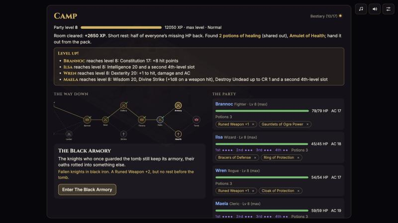
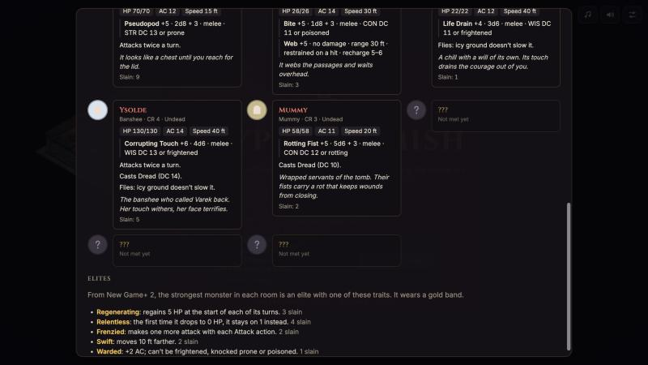
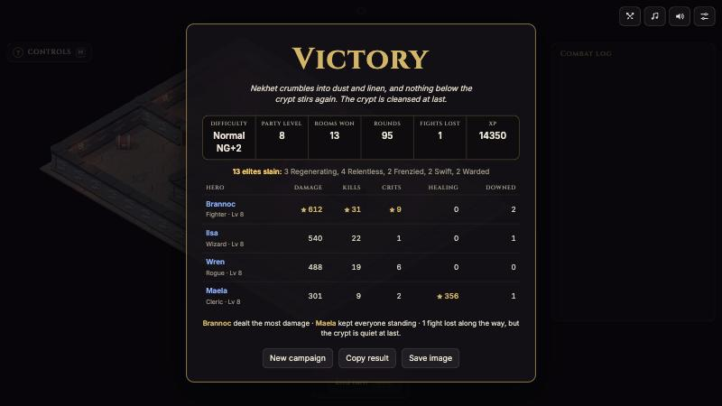
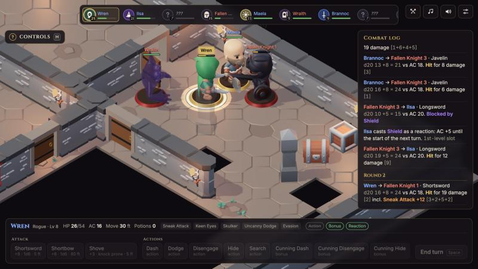
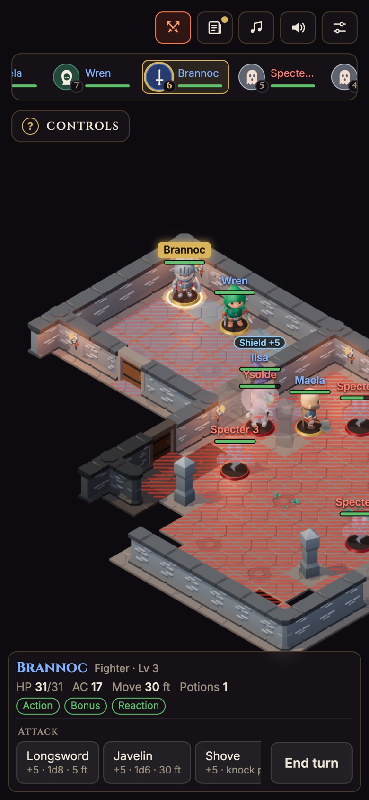
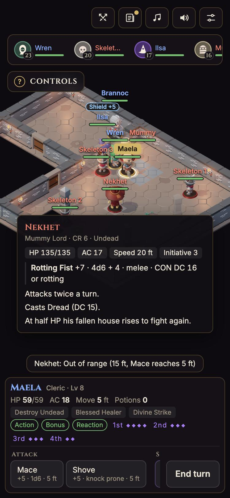

# Crypt Skirmish

Turn-based, isometric dungeon tactics in the browser, built with three.js and SRD 5e-style rules.

**Play it: https://fatihsenel.github.io/crypt-skirmish/**


| | |
| --- | --- |
|  |  |
|  |  |
|  |  |
|  |  |
|  |  |

A party of four fights its way down a crypt on a 5-ft grid, room by room, across four acts.
It runs on desktop and on phones, and once it has loaded it plays offline too.

**Contents:** [The party](#the-party) · [Rules](#rules) · [Monsters](#monsters) ·
[The dungeon](#the-dungeon) · [The campaign](#the-campaign) · [Modes and extras](#modes-and-extras) ·
[Interface](#interface) · [Sound](#sound) · [Controls](#controls) · [House rules](#house-rules) ·
[For developers](#for-developers) ·
[Credits](#credits)

## The party

| Hero | Class | Highlights |
| --- | --- | --- |
| Brannoc | Fighter | Second Wind, Extra Attack at level 5 |
| | *or* Paladin | Divine Smite, Lay on Hands, Shield of Faith, Aura of Protection |
| Ilsa | Wizard | Magic Missile, Burning Hands, Misty Step, Shield, then Fireball and Lightning Bolt |
| | *or* Warlock | Eldritch Blast, Hex, Scorching Ray, Hellish Rebuke, temp HP on kills |
| Wren | Rogue | Sneak Attack, Cunning Action, hides as a bonus action, spots traps |
| | *or* Ranger | Longbow with Archery, Hunter's Mark, Colossus Slayer |
| Maela | Cleric | Healing, Sacred Flame, Turn Undead, Spiritual Weapon |
| | *or* Bard | Bardic Inspiration, Cutting Words, Vicious Mockery, Shatter, Healing Word, Fear |

- Pick Paladin, Warlock, Ranger or Bard and rename the heroes under New campaign on the title screen.
- The party starts at level 3 and reaches level 8. Each level brings new spells, more attacks
  or more spell slots, up to 4th-level spells like Ice Storm and Death Ward.
- Ice Storm leaves its area icy: difficult terrain (each tile costs 10 ft of movement) until
  the end of the caster's next turn. Specters, wraiths and Ysolde fly over it.
- The Ranger is weaker than the SRD version so it doesn't outclass the Rogue.
- The Warlock has two pact slots that come back after every room.
- The Bard's Bardic Inspiration is a die given to an ally, used by itself on the first attack
  that misses, or save that fails, by no more than the die. Cutting Words spends a use and the
  Bard's reaction to take the die off a foe's hit, when it could turn it into a miss.

## Rules

- **The basics:** initiative, d20 attacks against AC, critical hits, 30 ft of movement, and
  one action, one bonus action and one reaction a round.
- **Advantage and disadvantage:** flanking, attacking from hiding or against an unaware foe
  gives advantage. Shooting with an enemy next to you, or at someone Dodging, gives
  disadvantage.
- **Opportunity attacks** when you leave an enemy's reach. Disengage avoids them.
- **Actions:** Dash, Dodge, Disengage, Hide, Search, Shove, Grapple, Help, Ready, drinking a
  potion or giving one to an ally next to you. Grapple, Disengage, Search, Help and Give potion
  wait behind **More** on the action bar, so the moves most turns need stay in one row.
- **Grapple:** instead of one attack, Athletics against the foe's STR or DEX. Win and it can't
  move while you stay next to it; it tries to break free at the start of each of its turns.
- **Help:** a hero distracts a foe next to them; the next ally to attack it before the
  helper's next turn has advantage.
- **Ready:** pick Ready, then the attack to hold until your next turn; it's made with your
  reaction. A melee weapon strikes the first foe to step into reach, a bow, javelin or Fire
  Bolt the first to step into view. Good for holding a doorway. A spell cast at one foe
  (Magic Missile, Sacred Flame, Scorching Ray, Dread, Vicious Mockery) can be readied too: its slot is spent
  when you ready it, and it goes off at the first foe to step into view.
- **Conditions:** prone, poisoned, frightened, restrained, rotting (a mummy's fist: no
  healing takes for two turns), mocked (Vicious Mockery: disadvantage on the next attack) and
  paralysed (a ghoul's claws: no move, action or reaction, and hits from next to you are
  critical), each shown as a tag on the figure.
- **Cover:** barrels, crates, a lowered portcullis and other creatures give +2 AC against
  attacks that pass over or through them (not one right next to the attacker).
- **Death saves:** a hero at 0 HP is dying and rolls a d20 as each of their turns comes round:
  10 or more is a success, three successes and they're stable, three failures and they're out
  for the fight. A 1 counts twice; a 20 brings them back with 1 HP. Any healing (a spell, Lay
  on Hands, a potion from an ally) gets them back up, prone. The pips on their initiative chip
  count the saves.
- **Concentration:** Hex, Hunter's Mark, Shield of Faith, Fear and Greater Invisibility last
  while the caster concentrates. Taking damage calls for a CON save (DC 10, or half the
  damage); a failure, dropping, being paralysed or casting another of them ends it.
- **Long range:** bows and javelins shoot up to four times their range, at disadvantage past
  it. Enemy reach marks the tiles only a long shot reaches with smaller, fainter dots.
- **Water and braziers:** shallow water costs double to wade through (fliers skip it). A hero
  next to a lit brazier can tip it over with their action: its coals land on the tiles past
  it, and whoever stands there makes a DC 12 DEX save against 2d6 fire (half on a success).
  The coals burn for 3 of the tipper's turns, 1d6 to anyone who steps on them.
- **Levers and portcullises:** a hero next to a lever pulls it for free (once a turn, like
  opening a chest), and every portcullis in the room crashes down, or rises again. Down, its
  bars stop anyone walking through, but not seeing or shooting. The clang wakes the room. The
  Black Armory has one, between its upper and lower halls.
- **Stealth:** a hidden hero is only found by a monster whose Perception beats their roll.
  Attacking gives you away.
- **Undo:** a move can be taken back until the hero does something else, as long as it rolled
  no dice and showed nothing new (no door, trap, monster or unexplored tile).

## Monsters

- Goblins, skeletons, an orc, giant rats, ghouls, a ghast, a mimic, giant spiders and
  specters.
- Act four: mummies, wraiths and fallen knights.
- Bosses: **Grukk** the goblin chief, **Morvath** the necromancer (raises the dead),
  **Varek** the wight, **Ysolde** the banshee and **Nekhet** the mummy lord (at half HP his
  dead rise again and his glare frightens heroes near him).
- Monsters start unaware. They notice heroes they can see, hear fighting nearby and shout to
  wake their allies. Some sleep, and some patrol.
- Goblins hide after shooting. Monsters that lose sight of a hidden hero go to where they last
  saw them and search.

## The dungeon

- Doors that block sight, hidden spike traps, chests with potions and magic items, and stairs
  down.
- **Fog of war:** you only see what your heroes see. Monsters out of sight are hidden.
- Walls in front of a figure turn see-through.

## The campaign

- **Four acts**, each a map with forks: choose which room to clear next, and whether to rest
  or push on for more XP and loot.
- Between rooms the party takes a short rest, shares XP and hands out magic items at camp.
- **Magic items:** Runed Weapons +1 and +2, Rings and Cloaks of Protection, Bracers of Defense
  (only for a hero in no armor), Gauntlets of Ogre Power, an Amulet of Health and a Periapt of
  Proof against Poison (and, from the Saint's Reliquary, a Periapt of Wound Closure). Each hero's button in the pack shows what the item would change for
  them, such as "AC 15 → 17" or "Max HP 35 → 53".
- **Relics:** each boss leaves one behind. A relic isn't worn: it works for the whole party
  for the rest of the run, and the camp lists them under Relics.
  - Morvath's Phylactery: the first hero who would drop to 0 HP stays on 1 HP. Once used, it
    sleeps until the next long rest (the camp shows it).
  - Varek's Barrow Horn: the heroes go first in every fight.
  - Ysolde's Veil: the party starts every fight hidden, even in plate; each hero stays hidden
    until they attack or cast, get hurt, or a sharp-eyed monster spots them.
  - Nekhet's Embalming Jar: the rest after each room gives back three-quarters of the missing
    HP, not half (New Game+ only, since Nekhet is the last boss).
- **Stops with no fight:** three side trips on the map, each one choice and no dice. Visit one
  on the way, or walk past it; the fork after it is still there.
  - The Wounded Pilgrim (after the Crypt): give up a potion and he finds you after the
    Sanctum with one for every hero, or take his purse for two potions now.
  - The Blood Altar (after the Nest): every hero loses a quarter of their HP maximum, and the
    party fights its next fight blessed, +1 to hit and +1 AC. The Shrine's rest keeps it.
  - The Saint's Reliquary (after the Halls): sealed unless the party carries the Iron Key from
    the Sealed Vault's chest. Inside: a Periapt of Wound Closure.
- A lost fight can be retried or skipped by taking another route. The Defeat screen tells how
  each hero fell, which foe hit hardest and who was still standing, with a tip for next time
  (a trap, unused potions, the healer falling first, a knock prone or a web before the last blow,
  a hero cut off alone, archers, spells, a foe to focus, spell slots left unspent). A won room says who led the way, the closest
  call, who fell and how many potions were drunk; won or lost, it sums the HP the party dealt
  and took.
- **Watch replay:** after any fight you played yourself, the end screen can play it again from
  the start, move by move with the same dice. Pause, step to the next turn, speed it up to 4×,
  or exit back to the end screen (keys: Space, →, + and −, Esc). Copy replay link puts the
  whole fight in a link (on a phone, the share sheet): whoever opens it watches the same fight,
  with nothing sent to a server. A link from before a rules change says it can't be shown.
- **Play it yourself:** a replay opened from a link has a Play it yourself button. You get the
  same room, party, difficulty and starting dice, and the end screen compares your rounds with
  the link's. Try again starts from the same dice; Copy replay link sends your fight back.
  Nothing is saved and no achievements are unlocked.
- **Challenge links:** Copy challenge link on the end screen makes a link that opens straight
  into the same fight, without showing yours first. The end screen then compares the rounds,
  and Watch yours and Watch theirs play both fights.
- **Difficulty:** Story, Normal or Hard. It changes the monsters only; Hard also leaves one
  ghoul out of the Barrow. After a third defeat in the same room, the Defeat banner offers
  Try again on Normal (from Hard) or Story (from Normal): the rest of the run goes on one step
  down, and the run's record and achievements count it at that difficulty.
- **Saving:** the run saves after every room and in the middle of a fight. Continue picks up
  on the same turn.
- Beating Nekhet shows a tally of the run and each hero's stats. Save image downloads it as a
  picture with the party's gear and the way down (on a phone, the share sheet). A run that ended at Ysolde
  before act four existed carries on into it.
- **New Game+:** after beating Nekhet, go back down with the same heroes from the first room.
  Each one keeps a magic item of your choice from the run. Every win adds a tier (Hard NG+1,
  NG+2, …): monsters get 10% more hit points per tier, and +1 to hit and damage. The relics
  come along too. The title
  screen offers it too, until you start a new campaign. Each hero may also keep nothing.
- **Elites:** from NG+2, the strongest monster in each room is an elite, with a gold band on
  its base, a gold edge on its portrait and one trait: Regenerating, Relentless, Frenzied, Swift,
  Warded or Barbed. The trait depends on the room and the tier: the camp map marks each room ahead
  with a gold pip, and picking it names the trait. When you first see the elite, a horn
  sounds, its band flares, a toast and the log name the trait, and on a phone the camera brings
  it into view. Aiming at a Barbed elite, the hint says what its barbs would cut you for, in
  red when that would drop you. Once you have won a campaign, the bestiary lists what each does and how many
  you've slain. The run summary, its image and Past runs count the elites slain.

## Modes and extras

- **Daily crypt:** one room a day, the same for everyone. Your best result and win streak
  are kept. From 20 November 2026 it can also be the Throne, the Halls or the Armory, and
  from 23 November its party (and the weekly's) can bring the Bard.
  Win it and Copy result puts a short summary on the clipboard (on a phone, the share sheet).
  A won campaign has the same button. Watch your best replays the day's fastest win from
  the title, and its Copy link and Copy challenge link share it.
- **Weekly elite crypt:** one room a week at New Game+ 3, the same for everyone, with that
  week's elite trait. It's a way to meet elites without a won campaign. Like the daily it
  keeps your best result and a streak of weeks won, and has a Copy result and Watch your best.
  If an update moves the week to another room, its best starts again there.
- **Achievements:** 36 goals that carry across runs. Open them from the title screen.
- **The title's skull** gapes, chatters and twitches on its own, and the embers in its eyes
  follow the pointer (on a phone, your taps) and flare at the title's buttons. Click or tap it
  (or press K) to play its moves in turn, each with its own sound: gape, chatter, cocked head,
  laugh, lunge and the torch guttering. A faint glow behind it pulses until the first click.
  It laughs on the won-campaign screen and chatters at you after a defeat, and a still of it
  shows while the game loads and on the saved run card. With Data Saver on or on a 2G
  connection the title keeps a still of it.
- **Bestiary:** every monster you've met, with its character card, a line of lore and how
  many you've slain. A note and a soft chime say when a new one joins, and a gold dot on its button waits
  until you look. Open it from the title screen or camp. It also keeps how much damage each
  kind has dealt your heroes and how many it dropped, with the three deadliest at the top.
- **Past runs:** your last 20 runs, from the title screen. Each keeps its last fight to watch
  again or copy as a link. Your deepest win (such as Hard NG+2) is kept and shown above them.
- **Tips for new players:** short hints the first time something matters, such as a brazier
  to tip, water in sight, foes hunting out of sight (Ready), a hurt ally next to you, a dying or
  paralysed hero, or a spell to concentrate on. They can be turned off.
- **Offline and on your Home Screen:** once everything has loaded, the foot of the title says
  "Saved for offline play", and the game then opens without a signal ("No signal: playing the
  saved copy"). On an iPhone it says how to add it to the Home Screen (Share, then Add to Home
  Screen); in Chrome or Edge it has an Install button. × hides that tip. When a new version
  is out, the title offers to reload into it.
- **Easy on phone batteries:** the board is drawn at full speed only while something moves
  or you touch the screen; the rest of the time a few frames a second keep the torches
  flickering, and the shadows are redrawn less often. Phones draw it at 1.5 pixels per point
  with a smaller shadow map. The title's skull slows down when left alone for 15 seconds.

## Interface

- **Dice on the board:** on your heroes' turns you throw the d20 yourself by clicking,
  tapping or pressing Space. Monsters' rolls and saving throws show too.
- **Enemy reach** (T): marks the tiles monsters could reach and hit next turn. A red
  crosshatch means melee, amber dots mean ranged, and fainter dots a long shot at disadvantage.
  Settings can switch them to purple and yellow for colour-blind players.
- **Odds:** hovering (or first tapping) a foe says the chance to hit, with advantage,
  disadvantage and cover counted, and the damage a hit does. Its HP bar shades what the hit
  would take off: dark for the lowest roll, striped up to the highest, and a ☠ by its name when
  even the lowest roll drops it. Spells with a save say the chance it fails. Reactions like
  Shield or Bardic Inspiration can still change the outcome.
- **Tooltips:** hover or long-press any attack, spell or tag to see what it does. Small
  labels (spell slots, potions, Action / Bonus / Reaction, the replay buttons' keys) show a
  short note on hover, focus or a tap; screen readers read every note with its label.
- **Turn order:** the round, then portraits along the top, each with its initiative number. Long names
  shrink to fit, like "G. Spider 2" or "R. Mummy". On an upright phone the whole party fits
  across; when more portraits are scrolled out of sight, that edge fades. Swipe it to see them.
- **Photo mode** (P, or the camera button): the HUD goes and the monsters wait. Drag to turn
  the view around the hero whose turn it is, right-drag to pan and scroll to zoom (on a phone,
  one finger turns, two pan and pinch). Save image keeps the picture (on a phone, the share
  sheet); Done or Esc puts the camera back.
- **Character cards:** hover a figure or a portrait (on a phone, tap a portrait or hold a figure) for its HP, AC,
  speed, attacks with to-hit and damage, conditions and traits.
- **Speech bubbles:** at the big moments a figure shouts a line over its head, typed out and
  gone in under two seconds: a hero's first blow of a fight, a critical hit, a kill, a friend
  falling ("Hold on, Maela!"), a big spell, healing a friend, getting back up ("I owe you
  one."), a named foe's first sight of the party ("You trespass in my barrow."), and now and
  then a monster's attack or spell (one of a pack a round; most of a named foe's). Each class
  and talking monster has its own voice; beasts, skeletons and spirits stay silent. One
  bubble at a time, and they never hold up a turn.
- **Settings:** volume for music, effects and voices, monster turn speed, the dice options,
  motion (System, Reduced or Full), text size (Normal, Large or Larger, for the panels, log,
  cards and the names and numbers over the figures), speech bubbles, colour-blind friendly
  enemy reach and play stats.
- **Play stats:** the deployed game sends anonymous events to Umami, and a count of each to the loss Worker (a run started or continued,
  a daily or weekly started, a room won or lost with its rounds and party classes, a stop's
  choice, a run abandoned, a campaign won, an easier difficulty offered or taken, a visit and whether its browser played before, a replay watched, something shared, a fight left
  half-way, with the input it was played by), how smoothly the board draws (a frame-rate band,
  once a visit), to see where runs end, and a crash by where it happened in the code (never its
  message), to find what breaks in which browser. A lost run or daily also sends its fight, without the heroes' names, so it can be
  watched (see Loss replays). No cookies, names or saves, and links' fights stay out of the
  address it sends. Off with Settings › Share anonymous play stats, or Do Not Track; test links
  and the dev server send nothing.

## Sound

Everything is generated in the browser, with no recordings:

- Music that grows from a quiet drone while exploring to drums and strings in a fight, with
  darker layers in boss rooms.
- Sound effects and dungeon ambience.
- Voices: every character shouts, chants and grunts in a made-up language.
- Sound starts with your first tap or key press, with a low toll. On an iPhone it plays in
  silent mode too, like a video does (iOS 17 and later); the Sound button mutes it.
- It goes quiet while the game is in the background (another tab or app, a locked screen)
  and picks up when you come back. The monsters wait for you too: their turn plays out once
  you're back, so you see what they do.
- With reduced motion (the Motion setting, or the system's when it's on System), the screen
  doesn't shake, the camera jumps instead of panning, floating numbers fade in place and the
  dice don't wobble, and the title's skull holds still.
- Screen readers hear the combat log as it happens (even with the log panel closed), whose
  turn it is, and what the keyboard cursor rests on with what Enter would do there. R reads
  out the board around the hero, and the number keys say what they picked. At camp they hear
  how the last room went, which room is next, each room on the map, and items handed out.
- The title, camp and New Game+ work from the keyboard alone: Tab to a room on the map, Enter
  to choose it, and focus stays where it was when the camp redraws.
- Tab to the combat log, and the arrow keys step from name to name in it (each is read out
  with its line); Enter looks at that figure, and F shows only the lines naming it.
- The end banner's Copy log puts the whole fight's log on the clipboard as plain text (on a
  phone, the share sheet). Where a browser won't let the game copy, Copy log, Copy result and
  the link buttons open the text selected in a panel, to copy by hand (or Save as file).
- Scrolled up in the combat log to read, new lines don't pull it back down; a button counts
  them and goes back. Each earlier round folds under a heading with who fell and the HP the
  party dealt and took.
- Double-click a name in the combat log (or hold it on a phone) to see only the lines naming
  that figure; "Only Wren ✕" above the log, or the same name again, shows every line.

## Controls

| Mouse and keyboard | Action |
| --- | --- |
| Click a tile | Move (blue = reachable, red dots = provokes an opportunity attack); a party member standing in front of a reachable tile doesn't block the click |
| Click an enemy | Attack with the best weapon in range |
| Attack / spell / action buttons | Pick a specific attack, spell or action |
| Click a chest | Open it when standing next to it |
| Right-drag / wheel | Pan / zoom |
| A name in the combat log | Hover marks that figure's tile, click looks at it, double-click shows only its lines; a monster's turn is one line, click it for the rolls |
| Hover a figure | Its last line in the combat log lights up; earlier rounds fold under their heading (click to open) |
| Arrow keys | Move a cursor over the board, starting at your hero |
| Enter on the cursor | Pick the tile (the hint shows what happens), Enter again to do it |
| 1–9, 0 | Pick the action bar's first ten buttons in order (attacks, spells, actions); the number shows on each |
| R | Read out the hero, enemies in sight (distance, HP, in range) and who's down |
| Space or Enter | End turn (or throw the die when it's waiting) |
| Esc | Un-pick the tile, cancel the selected attack or spell, then put the cursor away |
| Z | Undo the last move |
| T | Show or hide enemy reach |
| P | Photo mode: drag turns, right-drag pans, S saves the image, P or Esc leaves |
| M / N | Sound / music on or off |
| H or ? | Show or hide the controls panel (or click its header) |
| L | Fold or open the combat log (or click its header); remembered, and a folded log counts new lines |
| Tab to the combat log, then arrows / Enter / F | Step through the names in it / look at that figure / only its lines |
| K | On the title, or a defeat or the won campaign: the skull plays its next move |
| Tab / Esc in a panel | Tab stays inside the panel; Esc closes it |

| Touch | Action |
| --- | --- |
| Tap a tile, enemy or chest | Preview what would happen |
| Tap the same spot again | Do it |
| Drag / pinch | Pan / zoom |
| Undo button | Take back the last move |
| Hold a button, or tap a tag or label | Show its tooltip or note |
| Swipe the row of attacks and spells | See the rest; a faded edge means there are more |
| Tap a portrait or hold a figure | Show the character card |
| Log button (top right) | Open the combat log (its number counts new lines); tap a name in it to see that figure, hold it for only its lines |
| Camera button (top right) | Photo mode: one finger turns, two pan and pinch |

## House rules

A few things differ from the SRD to keep the game simple:

- Goblin arrows and rat bites poison (DC 10 CON). Ghoul claws paralyse (DC 10 CON). The save to end
  it comes at the start of each turn rather than the end, so a hero who makes it still acts
  (10 turns at most); the ghast's claws still only poison.
- The mimic knocks you prone instead of grappling.
- Only Grukk's second attack has disadvantage.
- Sculpt Spells and Sneak Attack 4d6 arrive at level 6. Sculpt spares every ally.
- The ghast's stench only lasts until the end of the victim's turn.
- A giant spider's bite poisons instead of dealing poison damage, and its web wears off on
  its own.
- A specter's Life Drain frightens instead of lowering maximum HP. The banshee has no Wail.
- Mummy rot is a short curse instead of a lasting one: on a failed CON save (DC 12, Nekhet's
  DC 16) the target can't regain HP for two of its turns. The wraith's Life Drain doesn't lower maximum HP and
  it raises no specters. Nekhet has no legendary actions or cleric spells. Instead, once a fight at half HP, two
  skeletons rise for him and heroes within 10 ft make a WIS save or are frightened.
- The Fighter's Improved Critical comes at level 7. A hero can use one runed weapon at a time.
- Gauntlets of Ogre Power also add +1 damage with Strength weapons, so they still help a
  hero whose Strength is already 19 or more.
- Hex has no ability-check part.
- Every Scorching Ray aims at one foe. Rays left when it falls go to the nearest other foe.
- Hellish Rebuke is armed ahead of time and only answers attacks.
- Bardic Inspiration uses come back every fight, and the die is rolled after the attack or save
  misses (only when it could turn it). Cutting Words only answers attack rolls.
- Fear spares the Bard's allies and doesn't make foes drop anything. Greater Invisibility only
  changes attack rolls.
- Ready has two fixed triggers instead of one you name: a foe stepping into reach (a melee
  attack) or into view (a ranged one, or a spell). A readied spell needs no concentration.
- Levers and portcullises are not from the SRD: pulling a lever is a free object interaction,
  it works every portcullis in the room, and it won't drop one on anyone.
- A grappled monster tries to break free at the start of its turn without spending its
  action, and a grappler who moves away lets go instead of dragging it. Only heroes grapple.
- New Game+ is not from the SRD: each tier adds 10% to monster hit points (on top of the
  difficulty's), and from the first tier their weapon attack and damage rolls get +1.
- Elites (NG+2 and deeper) are not from the SRD: the room's monster worth the most XP gets a
  trait (regains 5 HP a turn; stays on 1 HP once; one more attack; +10 ft speed; +2 AC and
  no frightened, prone or poisoned; or 3 piercing damage, no roll, to a foe that hits it with
  a melee weapon).
- Relics are not from the SRD. The Phylactery works like Death Ward on the first hero to drop,
  once between long rests. The Veil hides the party at 15 + Stealth bonus, with no roll and
  no penalty for noisy armor.
- Tipping a brazier is not from the SRD: the spill is a DC 12 DEX save against 2d6 fire, and
  the coals deal 1d6 to whoever enters them (once a turn) until the end of the tipper's third
  turn.
- The Periapt of Wound Closure doubles all healing its wearer receives (the SRD's doubles
  Hit Dice and stabilizes; there are no Hit Dice here).
- Death saves: monsters leave a dying hero alone, and a hero who fails three is out until the
  fight ends (back afterwards, as before). Monsters die at 0 HP.
- A creature gives half cover like a barrel: not one right next to the attacker.
- Fights saved, replayed or linked from before death saves, concentration, ghoul paralysis, long
  range and creature cover keep the old rules (`RULES` in `combat.js`).

## For developers

### Run

```bash
npm install
npm run dev      # http://localhost:5173
npm test         # rules unit tests (Vitest)
npm run lint     # ESLint: undefined names and unused code
npm run sim      # balance check: plays whole campaigns headlessly
npm run touch-check  # headless Chrome on a phone: first tap previews, second acts; the layout fits
npm run stills   # re-renders the icons, link preview, boot still and README shots of the 3D emblem
npm run build    # production bundle in dist/
npm run size-check  # the first screen's download stays within its budget (after a build)
npm run digest   # the week's play stats and stored losses as a short report (LOSS_READ_KEY set)
npm run preview  # http://localhost:4173/crypt-skirmish/
```

Every push to `main` runs lint and the tests, builds, checks the first screen's size, runs the touch check on three fixed fights against the
build (and once with each finger lifted late, as a busy phone sees it) and deploys to GitHub Pages (`.github/workflows/pages.yml`). Every Monday `.github/workflows/digest.yml`
runs the digest with the keys from the repository secrets `LOSS_READ_KEY` and `UMAMI_API_KEY` and keeps the report
as the run's `digest` artifact, out of the public log. Every day `.github/workflows/crash-check.yml`
fails, so GitHub emails, if the game crashed for anyone the day before (`scripts/crash-check.mjs`).

**Jump into a room:** `http://localhost:5173/?level=4` (1 Crypt, 2 Warren, 3 Ossuary,
4 Sanctum, 5 Catacombs, 6 Vault, 7 Barrow, 8 Larder, 9 Nest, 10 Gallery, 11 Throne,
12 Halls, 13 Armory, 14 Tomb). Add `&difficulty=hard` or `story`, `&party=5` for another level (3 to 8), `&tier=1` for New Game+, `&paladin`, `&ranger` or `&warlock`, `&relics=veil,horn` for boss relics (`phylactery`, `horn`, `veil`, `jar`), `&seed=7` for the same dice every time.
This doesn't touch the save.

**See the ending:** `http://localhost:5173/?victory` shows the won-campaign screen for a made-up run,
to try Copy result and Save image (on a phone, the share sheet). Add `&tier=2` for a New Game+
run with elites slain. Nothing is saved.

**Console:** `__debug.autoplay()` lets the AI play the heroes too. `__debug.win()` and
`__debug.lose()` end the fight.

### Balance

`scripts/sim.js` plays the campaign without graphics and prints win rates.

- `npm run sim -- 300` plays 300 campaigns down each route.
- `npm run sim -- 300 act2`, `act3` or `act4` plays just that act, starting from real parties
  that finished the act before.
- `npm run sim -- 300 full` plays whole runs, first room to the Tomb, and says where they end.
- Runs are split over one worker thread per core; `JOBS=1` plays them on one thread (the same
  numbers as before threads, for a given `SEED`).
- `SEED=n`, `DIFFICULTY=story|hard`, `TIER=n` (New Game+), `PALADIN=1`, `RANGER=1`, `WARLOCK=1` and `BARD=1` change the run.
- `RELICS=horn,veil` gives the party exactly those relics in every fight (`RELICS=` for none);
  without it they're earned from the bosses as in a real run.
- `EVENTS=1` takes the stops with no fight on the way (tends the pilgrim, bleeds at the altar,
  opens the reliquary with the key). On Normal it changes little; on Hard it costs about 5
  points, mostly the altar's blood before the Gallery.

Each act's boss is won almost every time by a rested party and noticeably less often by a
party that skipped the rest. On Normal the Throne is won about 98% of the time after a rest
and about 80% without one. The Tomb is the same: about 95% after the Hearth and 75% after the
Armory. On Hard the Throne drops to about 95% and 60%, and the Tomb to about 80% and 35%.
A whole run (900 simulated, relics earned from the bosses along the way) wins about 99% of the
time on Story, 87% on Normal and 51% on Hard (monsters get +20% HP and +1 to hit and damage);
with no relics, 97%, 78% and 35%. At New Game+ 3 with all four relics it's about 46%. Samples
of 300 runs swing by about 5 points either way.

[docs/stats.md](docs/stats.md) lists the play stats' events and how to read real players' win
and loss rates in Umami against these numbers.

### Loss replays

Lost fights go to a Cloudflare Worker (`worker/`, with a D1 database) and are kept for 60 days.
The unlisted page `?losses` lists them, newest first, by room, difficulty and mode, and opens
each in the game's replay. At the top, Play stats shows the last 7 or 30 days of the play-stats
counts (players, each room's fights and loss rate, crashes and where, input and frame rate), each with its change from the days before. Above the list, Where they fall counts each room's losses by
difficulty in the last 7 and 30 days, the most first; a room's name filters the list to it. It asks once for the Worker's read key. The Worker takes uploads
only from the game's page, about 3 a minute from one address (Cloudflare's rate limiter,
approximate, and the address is never stored), only a lost fight in the room it names, and at
most 1000 a day. It also counts the play-stats events by day (`/event`, at most 30 a minute from
one address and 20,000 a day, kept 400 days), which `npm run digest` reads with the same key
(`/tallies`). From `worker/`:
`npx wrangler deploy` deploys it, `npx wrangler secret put READ_KEY` sets the key, and
`npx wrangler d1 execute crypt-skirmish-losses --remote --file=schema.sql` makes the tables.

### Layout

```
src/
  game/              pure rules, no three.js (unit-testable)
    dice.js          dice rolling and ability modifiers
    grid.js          map grid, movement, line of sight, fog of war
    units.js         stat blocks, XP values and level-ups
    items.js         magic items and the bosses' relics
    abilities.js     actions and spells
    campaign.js      the dungeon map, XP, the pack, rests, New Game+, save data
    maps.js          the rooms as ASCII maps
    combat.js        Game: turns, movement, attacks, events
    spells.js        spell slots, targeting, saves and casting (Game builds on it)
    ai.js            monster brains
    replay.js        fight saves: commands replayed from a seed
    recap.js         a fight told back: who fell to what and a tip, or who led a win; HP totals
    history.js       past runs and the last fight of each
    fightLink.js     a fight as a #watch= link, checked by replaying it; #play= challenges and their end text
    achievements.js  achievements and their checks
    bestiary.js      which monsters you've met and slain, and what they did to you
    daily.js         the daily crypt
    weekly.js        the weekly elite crypt
    settings.js      settings kept in the browser
  render/            three.js only
    stage.js         renderer, camera, lights, screen shake, labels kept apart
    board.js         dungeon meshes, highlights, fog of war, wall fading
    dungeonKit.js    loads the dungeon tiles
    gltfModels.js    loads the character models and plays their animations
    modelSpecs.js    which model and clips each unit uses
    models.js        procedural figures (the mimic and fallbacks)
    unitView.js      a unit's base, label and animations
    speechBubble.js  the speech bubble over a figure's label: typed, held, faded
    effects.js       spell effects, hit particles
    rollBadge.js     the d20 badge over attacks and saves
    tween.js         promise-based tweening and playback speed
    titleLogo.js     the 3D emblem (title and won campaign): the skull, its jaw, the mist and wisps
  audio/             sfx.js, music.js, voices.js (all procedural)
  ui/
    hud.js           initiative, action bar, combat log
    announce.js      what a screen reader hears: log lines, turns, the keyboard cursor, camp news
    replayBar.js     the replay bar: pause, next turn, speed and their keys
    runCard.js       the won campaign drawn as a picture to save
    camp.js          title screen and camp
    heirlooms.js     New Game+: the item each hero keeps
    settings.js      the settings panel
    abilityTip.js    tooltip cards for attacks, spells and actions
    unitTip.js       the character card over figures and portraits
    unitCard.js      the character card's text
    bestiary.js      the bestiary screen and its lore
    banner.js        the end-of-fight banner: result, recap, run summary, Copy result, Save image, Copy log
    overlay.js       panels over the screen (bestiary, past runs, achievements, New Game+)
    icons.js         portrait icons for the turn order
    tips.js          tips for new players
    hints.js         the short notes on small labels (data-hint), on hover, focus or a tap
    copyBox.js       copying text: the clipboard, else a panel with it selected
    appStatus.js     the title's line about offline play, installing and a new version
  boot.js            the entry: the title and the saves, before three.js and main.js load
  main.js            controller: game → animations → HUD
  controls.js        mouse, touch and keyboard: the arrow-key cursor and the shortcut keys
  preview.js         what a click on the hovered tile would do: the path, the odds, a spell's blast
  fightEnd.js        a finished fight's records: runs, achievements, dailies, the end banner's facts
  animate.js         plays back resolved attacks, moves, chests, actions and spells
  speech.js          the speech bubbles' lines and when each figure speaks
  links.js           copying and opening #watch= and #play= links
  threats.js         threat zones: the T toggle and a monster's reach from its portrait
  photo.js           photo mode: no HUD, a free camera, Save image
  input.js           picking a tile, the long press, what a click does, the cursor's step and words
  debug.js           window.__debug and the ?victory sample run
  stats.js           anonymous play stats (Umami): the setting, the events, the script loaded after the title,
                     and the event counts and lost fights sent to the loss-replay Worker
  tallies.js         the Worker's event counts read into numbers (the digest, ?losses, the crash check)
  ui/losses.js       the unlisted ?losses page: play stats and players' lost fights to watch
  offline.js         registers the offline copy (public/sw.js), hands it the files already loaded, looks for a new deploy
tests/               Vitest rules, replay and input tests, and a check that every spell animates
scripts/
  sim.js             headless balance simulator
  touch-check.mjs    real touch taps and a phone layout check in headless Chrome (URL= for another server, SIDEWAYS=1 on its side)
  stills.mjs         stills of the 3D emblem and the README shots that show it (npm run stills)
  trim-models.js     strips unused animation clips from the models
  compress-models.js meshopt-compresses every .glb (npm run models)
  skull-glb.mjs      converts the title skull's OBJ scan to public/models/skull/skull.glb
  size-check.mjs     gzipped size of the title's code and of the skull against a budget
  digest.mjs         the weekly digest: the Worker's event tallies and stored losses (npm run digest)
  crash-check.mjs    the daily crash check: yesterday's crashes from the tallies (GitHub Actions)
public/sw.js         the offline copy: pages from the network first, everything else saved
worker/              the loss-replay Cloudflare Worker (src/index.js), its table (schema.sql) and wrangler.toml
docs/stats.md        the play stats' events, and reading them in Umami
```

The rules engine resolves everything instantly and emits events (`attack`, `move`, `spell`,
`death`, …). The controller plays them back as animations, so the visuals can change without
touching the rules.

Models load room by room, so a fight only waits for its own figures. They are trimmed to the
clips the game uses and meshopt-compressed (about 1.1 MB of characters). To add a clip, bring
back the original file from git history, then trim and compress again.

The title is plain HTML, and `boot.js` puts it up before three.js and the rest of the game
arrive: about 65 kB gzipped. A press on it waits for `main.js`. The skull loads next (about
220 kB), then three.js and the game, the dungeon tiles and the figures. Once a production
build has loaded, a service worker keeps a copy of everything it fetched, the Google fonts
too, so the game opens without a signal; a new deploy shows up on the next visit online, and
an open title offers it.

## Credits

- **Characters:** KayKit Adventurers and KayKit Skeletons by Kay Lousberg
  (www.kaylousberg.com), CC0.
- **Monsters:** the orc, specters, giant rats and spiders by Quaternius (quaternius.com), CC0,
  via Poly Pizza.
- **Dungeon tiles and props:** KayKit Dungeon Remastered by Kay Lousberg, CC0.
- **Logo and icons:** the flat emblem and the favicon are drawn for the game as SVG. The
  lettering uses Cinzel from Google Fonts. The title's 3D skull is "Human Skull" by CDmir on
  OpenGameArt, CC0, converted to glTF; the doorway, sword and staff around it are built in code. The app icons,
  the link preview and the loading screen's emblem are stills of it.
- License files are in `public/models`. If a model fails to load, the game falls back to a
  simple procedural figure.

Rules content follows the SRD 5.1 (CC-BY-4.0). Credit it if you publish, and avoid non-SRD
names and Wizards of the Coast trademarks.
