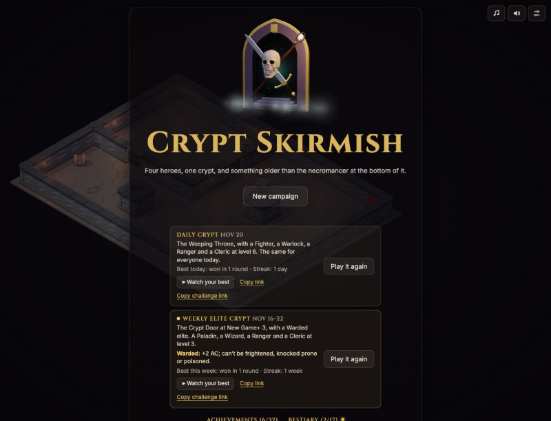
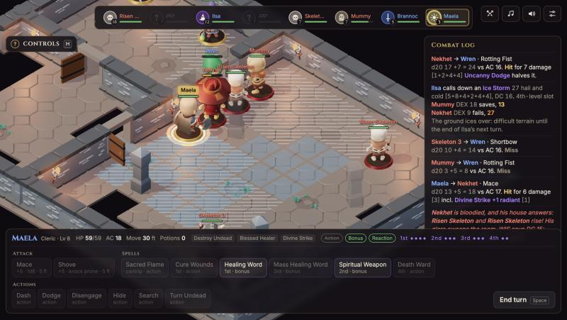

# Crypt Skirmish

Turn-based, isometric dungeon tactics in the browser, built with three.js and SRD 5e-style rules.

**Play it: https://fatihsenel.github.io/crypt-skirmish/**


| | |
| --- | --- |
|  |  |
|  |  |
|  |  |

A party of four fights its way down a crypt on a 5-ft grid, room by room, across four acts.
It runs on desktop and on phones.

**Contents:** [The party](#the-party) · [Rules](#rules) · [Monsters](#monsters) ·
[The dungeon](#the-dungeon) · [The campaign](#the-campaign) · [Modes and extras](#modes-and-extras) ·
[Interface](#interface) · [Sound](#sound) · [Controls](#controls) · [House rules](#house-rules) ·
[For developers](#for-developers) ·
[Credits](#credits)

## The party

| Hero | Class | Highlights |
| --- | --- | --- |
| Brannoc | Fighter | Second Wind, Extra Attack at level 5 |
| | *or* Paladin | Divine Smite, Lay on Hands, Shield of Faith, Aura of Protection |
| Ilsa | Wizard | Magic Missile, Burning Hands, Misty Step, Shield, then Fireball and Lightning Bolt |
| | *or* Warlock | Eldritch Blast, Hex, Scorching Ray, Hellish Rebuke, temp HP on kills |
| Wren | Rogue | Sneak Attack, Cunning Action, hides as a bonus action, spots traps |
| | *or* Ranger | Longbow with Archery, Hunter's Mark, Colossus Slayer |
| Maela | Cleric | Healing, Sacred Flame, Turn Undead, Spiritual Weapon |

- Pick Paladin, Warlock or Ranger and rename the heroes on the title screen.
- The party starts at level 3 and reaches level 8. Each level brings new spells, more attacks
  or more spell slots, up to 4th-level spells like Ice Storm and Death Ward.
- Ice Storm leaves its area icy: difficult terrain (each tile costs 10 ft of movement) until
  the end of the caster's next turn. Specters, wraiths and Ysolde fly over it.
- The Ranger is weaker than the SRD version so it doesn't outclass the Rogue.
- The Warlock has two pact slots that come back after every room.

## Rules

- **The basics:** initiative, d20 attacks against AC, critical hits, 30 ft of movement, and
  one action, one bonus action and one reaction a round.
- **Advantage and disadvantage:** flanking, attacking from hiding or against an unaware foe
  gives advantage. Shooting with an enemy next to you, or at someone Dodging, gives
  disadvantage.
- **Opportunity attacks** when you leave an enemy's reach. Disengage avoids them.
- **Actions:** Dash, Dodge, Disengage, Hide, Search, Shove and drinking a potion.
- **Conditions:** prone, poisoned, frightened, restrained and rotting (a mummy's fist: no
  healing takes for two turns), each shown as a tag on the figure.
- **Cover:** barrels and crates give +2 AC against attacks that pass over them.
- **Stealth:** a hidden hero is only found by a monster whose Perception beats their roll.
  Attacking gives you away.

## Monsters

- Goblins, skeletons, an orc, giant rats, ghouls, a ghast, a mimic, giant spiders and
  specters.
- Act four: mummies, wraiths and fallen knights.
- Bosses: **Grukk** the goblin chief, **Morvath** the necromancer (raises the dead),
  **Varek** the wight, **Ysolde** the banshee and **Nekhet** the mummy lord (at half HP his
  dead rise again and his glare frightens heroes near him).
- Monsters start unaware. They notice heroes they can see, hear fighting nearby and shout to
  wake their allies. Some sleep, and some patrol.
- Goblins hide after shooting. Monsters that lose sight of a hidden hero go to where they last
  saw them and search.

## The dungeon

- Doors that block sight, hidden spike traps, chests with potions and magic items, and stairs
  down.
- **Fog of war:** you only see what your heroes see. Monsters out of sight are hidden.
- Walls in front of a figure turn see-through.

## The campaign

- **Four acts**, each a map with forks: choose which room to clear next, and whether to rest
  or push on for more XP and loot.
- Between rooms the party takes a short rest, shares XP and hands out magic items at camp.
- A lost fight can be retried or skipped by taking another route.
- **Difficulty:** Story, Normal or Hard. It changes the monsters only; Hard also leaves one
  ghoul out of the Barrow.
- **Saving:** the run saves after every room and in the middle of a fight. Continue picks up
  on the same turn.
- Beating Nekhet shows a tally of the run and each hero's stats. A run that ended at Ysolde
  before act four existed carries on into it.

## Modes and extras

- **Daily crypt:** one room a day, the same for everyone. Your best result and win streak
  are kept. From 20 November 2026 it can also be the Throne, the Halls or the Armory.
- **Achievements:** 23 goals that carry across runs.
- **Past runs:** the title screen lists your last 20 runs.
- **Tips for new players:** short hints the first time something matters. They can be turned
  off.

## Interface

- **Dice on the board:** on your heroes' turns you throw the d20 yourself by clicking,
  tapping or pressing Space. Monsters' rolls and saving throws show too.
- **Enemy reach** (T): stripes the tiles monsters could reach and hit next turn. Red means
  melee and amber means ranged.
- **Tooltips:** hover or long-press any attack, spell or tag to see what it does.
- **Turn order:** portraits along the top, each with its initiative number.
- **Character cards:** hover a figure or a portrait (tap a portrait on a phone) for its HP, AC,
  speed, attacks with to-hit and damage, conditions and traits.
- **Settings:** volume for music, effects and voices, monster turn speed, and the dice options.

## Sound

Everything is generated in the browser, with no recordings:

- Music that grows from a quiet drone while exploring to drums and strings in a fight, with
  darker layers in boss rooms.
- Sound effects and dungeon ambience.
- Voices: every character shouts, chants and grunts in a made-up language.

## Controls

| Mouse and keyboard | Action |
| --- | --- |
| Click a tile | Move (blue = reachable, red dots = provokes an opportunity attack) |
| Click an enemy | Attack with the best weapon in range |
| Attack / spell / action buttons | Pick a specific attack, spell or action |
| Click a chest | Open it when standing next to it |
| Right-drag / wheel | Pan / zoom |
| Space or Enter | End turn (or throw the die when it's waiting) |
| Esc | Cancel the selected attack or spell |
| T | Show or hide enemy reach |
| M / N | Sound / music on or off |
| H | Show or hide the controls panel |

| Touch | Action |
| --- | --- |
| Tap a tile, enemy or chest | Preview what would happen |
| Tap the same spot again | Do it |
| Drag / pinch | Pan / zoom |
| Hold a button, or tap a tag | Show its tooltip |
| Tap a portrait | Show the character card (tap again to close) |
| Log button (top right) | Open the combat log |

## House rules

A few things differ from the SRD to keep the game simple:

- Goblin arrows and rat bites poison (DC 10 CON). Ghoul claws poison instead of paralysing.
- The mimic knocks you prone instead of grappling.
- Only Grukk's second attack has disadvantage.
- Sculpt Spells and Sneak Attack 4d6 arrive at level 6. Sculpt spares every ally.
- The ghast's stench only lasts until the end of the victim's turn.
- A giant spider's bite poisons instead of dealing poison damage, and its web wears off on
  its own.
- A specter's Life Drain frightens instead of lowering maximum HP. The banshee has no Wail.
- Mummy rot is a short curse instead of a lasting one: on a failed CON save (DC 12, Nekhet's
  DC 16) the target can't regain HP for two of its turns. The wraith's Life Drain doesn't lower maximum HP and
  it raises no specters. Nekhet has no legendary actions or cleric spells. Instead, once a fight at half HP, two
  skeletons rise for him and heroes within 10 ft make a WIS save or are frightened.
- The Fighter's Improved Critical comes at level 7. A hero can use one runed weapon at a time.
- Hex has no ability-check part and lasts the whole fight, with no concentration.
- Every Scorching Ray aims at one foe. Rays left when it falls go to the nearest other foe.
- Hellish Rebuke is armed ahead of time and only answers attacks.

## For developers

### Run

```bash
npm install
npm run dev      # http://localhost:5173
npm test         # rules unit tests (Vitest)
npm run sim      # balance check: plays whole campaigns headlessly
npm run build    # production bundle in dist/
npm run preview  # http://localhost:4173/crypt-skirmish/
```

Every push to `main` runs the tests, builds and deploys to GitHub Pages
(`.github/workflows/pages.yml`).

**Jump into a room:** `http://localhost:5173/?level=4` (1 Crypt, 2 Warren, 3 Ossuary,
4 Sanctum, 5 Catacombs, 6 Vault, 7 Barrow, 8 Larder, 9 Nest, 10 Gallery, 11 Throne,
12 Halls, 13 Armory, 14 Tomb). Add `&difficulty=hard` or `story`, `&party=5` for another level (3 to 8), `&paladin`, `&ranger` or `&warlock`.
This doesn't touch the save.

**Console:** `__debug.autoplay()` lets the AI play the heroes too. `__debug.win()` and
`__debug.lose()` end the fight.

### Balance

`scripts/sim.js` plays the campaign without graphics and prints win rates.

- `npm run sim -- 300` plays 300 campaigns down each route.
- `npm run sim -- 300 act2`, `act3` or `act4` plays just that act, starting from real parties
  that finished the act before.
- `npm run sim -- 300 full` plays whole runs, first room to the Tomb, and says where they end.
- Runs are split over one worker thread per core; `JOBS=1` plays them on one thread (the same
  numbers as before threads, for a given `SEED`).
- `SEED=n`, `DIFFICULTY=story|hard`, `PALADIN=1`, `RANGER=1` and `WARLOCK=1` change the run.

Each act's boss is won almost every time by a rested party and noticeably less often by a
party that skipped the rest. On Normal the Throne is won about 98% of the time after a rest
and about 80% without one. The Tomb is the same: about 95% after the Hearth and 75% after the
Armory. On Hard the Throne drops to about 95% and 65%, and the Tomb to about 85% and 45%.
A whole run (1,500 simulated) wins about 97% of the time on Story, 68% on Normal and 35% on
Hard (monsters get +10% HP and +1 to hit and damage). On both the Tomb ends the most runs. Samples of 300 runs swing by about 5 points either way.

### Layout

```
src/
  game/              pure rules, no three.js (unit-testable)
    dice.js          dice rolling and ability modifiers
    grid.js          map grid, movement, line of sight, fog of war
    units.js         stat blocks, XP values and level-ups
    items.js         magic items
    abilities.js     actions and spells
    campaign.js      the dungeon map, XP, the pack, rests, save data
    maps.js          the rooms as ASCII maps
    combat.js        Game: turns, movement, attacks, spells, events
    ai.js            monster brains
    replay.js        fight saves: commands replayed from a seed
    history.js       past runs
    achievements.js  achievements and their checks
    daily.js         the daily crypt
    settings.js      settings kept in the browser
  render/            three.js only
    stage.js         renderer, camera, lights, screen shake, labels kept apart
    board.js         dungeon meshes, highlights, fog of war, wall fading
    dungeonKit.js    loads the dungeon tiles
    gltfModels.js    loads the character models and plays their animations
    modelSpecs.js    which model and clips each unit uses
    models.js        procedural figures (the mimic and fallbacks)
    unitView.js      a unit's base, label and animations
    effects.js       spell effects, hit particles
    rollBadge.js     the d20 badge over attacks and saves
    tween.js         promise-based tweening and playback speed
  audio/             sfx.js, music.js, voices.js (all procedural)
  ui/
    hud.js           initiative, action bar, combat log
    camp.js          title screen and camp
    settings.js      the settings panel
    abilityTip.js    tooltip cards for attacks, spells and actions
    unitTip.js       the character card over figures and portraits
    icons.js         portrait icons for the turn order
    tips.js          tips for new players
  main.js            controller: input → game → animations → HUD
tests/               Vitest rules and replay tests
scripts/
  sim.js             headless balance simulator
  trim-models.js     strips unused animation clips from the models
  compress-models.js meshopt-compresses every .glb (npm run models)
```

The rules engine resolves everything instantly and emits events (`attack`, `move`, `spell`,
`death`, …). The controller plays them back as animations, so the visuals can change without
touching the rules.

Models load room by room, so a fight only waits for its own figures. They are trimmed to the
clips the game uses and meshopt-compressed (about 1.1 MB of characters). To add a clip, bring
back the original file from git history, then trim and compress again.

## Credits

- **Characters:** KayKit Adventurers and KayKit Skeletons by Kay Lousberg
  (www.kaylousberg.com), CC0.
- **Monsters:** the orc, specters, giant rats and spiders by Quaternius (quaternius.com), CC0,
  via Poly Pizza.
- **Dungeon tiles and props:** KayKit Dungeon Remastered by Kay Lousberg, CC0.
- **Logo and icons:** drawn for the game as SVG. The lettering uses Cinzel from Google Fonts.
- License files are in `public/models`. If a model fails to load, the game falls back to a
  simple procedural figure.

Rules content follows the SRD 5.1 (CC-BY-4.0). Credit it if you publish, and avoid non-SRD
names and Wizards of the Coast trademarks.
