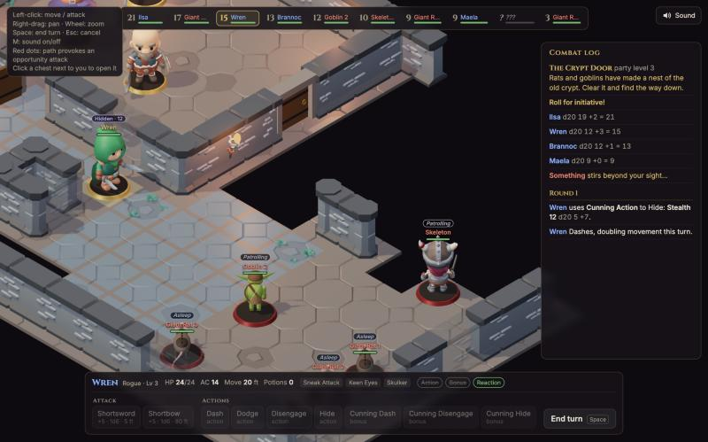

# Crypt Skirmish — isometric D&D-style tactics in three.js

**Play it in the browser: https://fatihsenel.github.io/crypt-skirmish/**




A small turn-based dungeon crawl: a party of four (Fighter, Wizard, Rogue, Cleric) fights
its way down a crypt on a 5-ft grid, with SRD 5e-style rules:

- initiative, d20 attack rolls vs AC, crits, ability modifiers, 30 ft movement
- action economy: one action, one bonus action and one reaction per round
- **advantage / disadvantage**: flanking (an ally on the far side) gives melee advantage;
  ranged attacks with an enemy adjacent, or against a Dodging target, have disadvantage
- **opportunity attacks** when you leave an enemy's reach (Disengage prevents them)
- actions: Dash, Dodge, Disengage; Fighter **Second Wind** and Goblin **Nimble Escape** (bonus actions)
- Wizard spell slots (4 × 1st, 2 × 2nd): **Magic Missile**, **Burning Hands** (15-ft cone,
  DEX save, hits allies too), **Misty Step** (bonus-action teleport), **Shield** (automatic reaction)
- **Rogue**: Sneak Attack (+2d6 once per turn with advantage or an ally next to the target),
  Cunning Action (bonus-action Dash / Disengage), Keen Eyes (spots traps within 10 ft)
- **Cleric**: Sacred Flame (cantrip, DEX save), Cure Wounds, Healing Word (bonus action, 60 ft)
  and **Turn Undead** (undead within 30 ft make a WIS save or flee for 2 turns, or until hurt)
- **Paladin** (optional: picked on the title screen in place of the Fighter, as Brannoc in
  white and gold with a crested shield): 28 HP, AC 18, three 1st-level slots and the
  **Dueling** style (+2 melee damage). **Divine Smite** is a toggle in the Attack group: armed,
  the next melee weapon hit spends the lowest slot for 2d8 radiant (+1d8 per slot level above
  1st, +1d8 against undead; a crit doubles it), then it disarms. **Lay on Hands** heals a
  neighbour or yourself from a pool of 5 HP per level that only a long rest refills, and
  **Shield of Faith** (bonus action, 60 ft) gives one ally +2 AC for the fight, until it moves
  to someone else or the paladin falls
- **Ranger** (optional: picked on the title screen in place of the Rogue, as Wren in dark
  leather with a crossbow; the rules call it a longbow, as the model pack has no bow): 24 HP,
  AC 15, a 120-ft longbow with the **Archery** style (+1 to hit with ranged weapons), three
  1st-level slots and the Rogue's Keen Eyes for traps and mimics. **Hunter's Mark** (bonus
  action, 90 ft) adds 1d6 to every weapon hit on one foe for the fight (marking wakes it if
  it was asleep or unaware). The Ranger hides as an action, trained in Stealth but not an
  expert, and has no healing. Toned down from the SRD so it doesn't outclass the Rogue: no
  Cure Wounds, 24 HP instead of 28, Archery +1 instead of +2, every new Hunter's Mark costs
  a slot (the SRD moves it for free when its foe drops), and Colossus Slayer waits for level 5
- monsters: goblins (skirmishers), skeletons (brutes, undead), an **orc** that charges
  (Aggressive), **giant rats** with Pack Tactics, **Grukk the goblin boss** (two attacks, the
  second at disadvantage) and **Morvath the necromancer**, who raises corpses with
  **Animate Dead**, and the risen skeleton acts right after him (he also casts **Dread**).
  Act three adds **giant spiders**, **specters** and **Ysolde the banshee** (see below)
- **conditions** that feed advantage / disadvantage:
  - **prone**: melee attacks against you have advantage, ranged ones disadvantage, and your
    own attacks have disadvantage. You stand up at the start of your turn for half your
    movement. Failing a trap's save knocks you prone and ends your move there
  - **Shove** (uses one attack): STR (Athletics) against the target's STR or DEX; a win knocks
    it prone, and ties go to the target. Too-big targets (the mimic) can't be shoved
  - **poisoned**: disadvantage on attacks and on Hide. Goblin arrows, rat bites and ghoul claws
    poison on a failed CON save
  - **frightened** (**Dread**, 1st-level spell, WIS save): disadvantage on attacks while the
    source is in sight, and you can't step closer to it. Repeat the save at the end of each
    of your turns; it also ends if the source dies
  - **restrained** (a giant spider's **Web**: a ranged attack with no damage and no save,
    Recharge 5–6): you can't move, attacks against you have advantage, and your own attacks
    and DEX saves have disadvantage. It wears off at the end of your next turn
  - poisoned, frightened and restrained always last through the victim's next turn. Tags show on the figure
- the dungeon: **doors** that block sight until opened, hidden **spike traps** (DEX save,
  2d6), **chests** with potions of healing, and **stairs** to the next level
- **room dressing**: barrels and crates are in the way and give **half cover**: +2 AC
  against an attack that crosses one, unless it stands right next to the attacker (you lean
  over your own barricade). The log marks it. Columns block movement and sight like walls.
  Goblin archers prefer targets out in the open and like to end their move behind a barrel.
  Some crates carry a lit candle
- **a campaign**: a dungeon map with a fork. After the Crypt Door, pick the Goblin Warren or
  the Flooded Ossuary; then either rest at the Forgotten Chapel (long rest) or clear the
  other room too (more XP and loot, but no rest) before the Necromancer's Sanctum
- **act two**: Morvath's fall is followed by a long rest, then the **Catacombs** (ghouls: two
  poisoning claws each),
  a fork between the **Sealed Vault** (treasure, including a Cloak of Protection, and a
  **mimic** posing as a chest) and a rest at the **Still Well**, then an optional detour
  through the **Larder** (a **ghast** and its ghouls; the ghast's stench poisons any hero
  who starts a turn next to it and fails a DC 10 CON save, and one success makes them
  immune for the fight), and finally the
  **Wight's Barrow**, where Varek the wight (110 HP, two attacks, a longbow, Dread) waits. The
  party reaches act two at level 5 and level 6 after the Catacombs, and these monsters are
  tougher than their SRD stat blocks
  to match (see Balance below). Opening the
  mimic wakes it: it joins the initiative right after the opener and bites with advantage,
  unless Wren's Keen Eyes spotted it from within 10 ft (the log warns you, and hovering the
  chest says so)
- **act three**: the Barrow now ends act two with a long rest. Below it, the **Spider Nest**
  (giant spiders that web and poison, and rats), then a fork between the **Haunted Gallery**
  (specters, whose Life Drain touch frightens, and skeletons, guarding a Cloak of Protection
  and a Runed Weapon) and a rest at the **Silent Shrine**, and finally the **Weeping Throne**,
  where **Ysolde the banshee** (130 HP, two frightening touches, Dread) waits with her
  specters. Specters and the banshee are undead, so Turn Undead works on them.
  A run that already finished at the Barrow carries on into act three, rested
- between rooms the party keeps HP, spell slots and potions, takes a short rest (regain half
  the missing HP; the fallen get back up) and shares **XP**. A lost fight can be retried as
  you entered it, or you can go back to the map and pick another way
- **levelling** from 3 to 6 (450 / 900 / 2000 party XP): more HP and a +2 to the main ability at 4;
  at 5, Brannoc gets **Extra Attack** (the Paladin also two 2nd-level slots), Ilsa
  **Fireball** (20-ft radius, hits allies too) and **Lightning Bolt** (a 100-ft line, 5 ft
  wide, 8d6 lightning with a DEX save for half; walls stop it, and it hits allies in the
  line too), Wren Sneak Attack 3d6 and **Uncanny Dodge** (the Ranger Extra Attack, **Colossus Slayer**
  (+1d8 once per turn to a weapon hit on a foe that is already hurt), a fourth
  1st-level slot and two 2nd-level ones), Maela **Mass Healing Word**,
  **Spiritual Weapon** (bonus action: a floating spectral mace appears beside a foe within
  60 ft and makes a melee spell attack for 1d8 + WIS force; for the rest of the fight it
  strikes again as a bonus action, with no slot, at any foe within 25 ft of it, and it fades
  if Maela falls) and **Destroy Undead**, plus 3rd-level slots for both casters. Level 6 comes after the
  Catacombs: Brannoc Strength 20 (the Paladin **Aura of Protection**: allies within 10 ft add
  the paladin's CHA modifier, +3, to saving throws), Ilsa **Sculpt Spells** (her Fireball, Lightning Bolt and
  Burning Hands spare the party), Wren Sneak Attack 4d6 (the Ranger **Escape the Horde**:
  opportunity attacks against you have disadvantage, which in the SRD comes at level 7), Maela Turn Undead twice per fight and
  **Blessed Healer** (healing someone else with a slot heals her for 2 + the slot level),
  and a third 3rd-level slot for both casters
- **difficulty**, picked on the title screen for a new run: **Story** (monsters have ¾ HP
  and −1 to hit and damage), **Normal**, or **Hard** (1.2× HP, +1 to hit and damage). It
  applies to every monster, including mimics and the risen dead; the heroes are unchanged
- **hero names and class**: "Name your heroes, pick a class" on the title screen renames
  Brannoc, Ilsa, Wren and Maela for a new run (letters, numbers, spaces, apostrophes and
  hyphens, up to 14 characters; a blank field keeps the default), and its Fighter / Paladin
  and Rogue / Ranger switches pick those heroes' classes. The choice is kept in the save;
  older saves load as a Fighter and a Rogue
- **magic items** from chests (Runed Weapon +1, Ring of Protection, Cloak of Protection) go into the pack and
  are handed out at camp
- **turn order**: each initiative chip carries a small portrait on the unit's own colour: a
  class icon for the heroes (sword, crested shield, wizard's hat, hood, bow, sun) and a silhouette
  for each monster (goblin, crowned boss, orc, rat, skull, hooded necromancer, ghoul claws,
  the ghast's reeking claws, the wight's crowned skull, a toothy chest, a spider, a hooded
  wisp for the specter and a crowned one for the banshee), with the
  initiative number on a badge
- **fog of war**: you only see what your heroes can see. Rooms you have seen stay dimly
  drawn; monsters out of sight are hidden (their initiative chips show a `?` and read `???` until spotted)
  and their turns pass quickly while "something moves in the dark"
- **monster senses**: monsters start unaware. They notice a hero they can see within 8
  tiles (3 for Wren the Rogue, a *skulker*; not the Ranger), hear fighting within 5 tiles of walking distance (a closed
  door counts as 2 more; 3rd-level spells carry to 8), and a monster that spots you or gets hurt shouts to unaware
  allies within 4 tiles that can see it (a roused ally doesn't pass the alarm on). Unaware
  monsters make no opportunity attacks and are attacked with advantage (so Sneak Attack
  works on them). Some **sleep** (they see nothing and only wake to noise within 2 tiles,
  a shout, or a blow); some **patrol**, walking a beat at half speed until they notice you
- **stealth**: any hero can take the **Hide** action (Wren as a bonus action, with
  expertise; Brannoc and Maela roll with disadvantage in heavy armour). A hidden hero is
  only spotted by a monster whose passive Perception (10 + WIS) reaches the Stealth roll,
  or one right next to them. The first attack from hiding has advantage; attacking or
  casting gives you away. You can't hide while an alert enemy can see you
- **searching monsters**: alert monsters lose track of a hidden hero. They remember the
  last tile where they saw each hero (even partway through a move), walk there (Dashing if
  it's far), and take the **Search** action: a Perception roll against the hero's Stealth
  for every hidden hero in sight, which finds them on a success. With no lead, they stay
  put and Search
- **goblins that hide**: goblins use **Nimble Escape** to Hide as a bonus action (Stealth
  with expertise), usually after shooting. They need something to hide behind: out of the
  heroes' sight, or behind a barrel or crate, and they end their moves in such spots. A
  hidden goblin is drawn as a ghost with a "Hidden" tag and can't be targeted. A hero
  standing next to it, one with a clear view of it, or one whose passive Perception
  reaches its roll spots it; otherwise the
  heroes' **Search** action rolls Perception against every hidden goblin in sight. Attacking
  or getting hurt gives a goblin away
- **atmosphere**: walls in front of a figure turn see-through; hits spray blood (bone chips
  from the undead), fire bolts burst into embers, critical hits and Fireball shake the
  screen, and a natural 20 or 1 throws a tumbling d20 over the attacker
- **tips for new players** (optional): short hints pop up during the first fights at the
  moment they matter (moving, attacking, spells, chests, potions, opportunity attacks,
  ending the turn, camp), each once. Switch them off on any tip or on the title screen;
  switching them back on there shows them all again
- **past runs**: the title screen lists the last 20 runs: won, or abandoned (Abandon run at
  camp, or a new campaign over the save) and how far the party got, with difficulty, date,
  party level, rooms won, rounds, the party and who dealt the most damage. An abandoned run
  that never won a room isn't kept
- **achievements**: 12 goals that last across runs, such as winning a room in 3 rounds,
  defeating a mimic, beating a boss without a hero falling, or winning a campaign on Hard.
  New ones show on the victory banner; the title screen lists them all, locked ones dimmed.
  Test rooms opened with `?level=` don't count
- **voices**: every character barks in a made-up tongue, synthesized from formant filters
  (no recordings). Heroes shout on attacks, chant spells, grunt when hit and cry out when
  they fall; goblins, bugbears and orcs snarl, the necromancer intones, specters moan,
  spiders chitter, skeletons rattle and Ysolde wails
- **music**, generated in the browser like the sound effects: a low tritone drone under
  a soft, dark pad while you explore; drums, a bass ostinato and trembling strings swell in
  once monsters notice the party, and the boss rooms add a sinking drone and quick ticks,
  then fade back when the room is quiet. The
  Music button (or N) turns it off; Sound (or M) mutes everything
- **the ending**: beating Ysolde shows the run's tally: difficulty, party level, rooms won,
  rounds fought, fights lost and XP, then each hero's damage dealt, kills, critical hits,
  healing given and times downed, with a star on whoever leads each column. Lost fights
  count toward the tally; hero numbers come from the fights that were won
- **saves**: the run is saved to the browser after every room; the title screen offers
  Continue. A fight in progress is saved too, as its dice seed plus the commands the
  heroes were given; reloading replays them and picks up on the same turn. If a save
  no longer replays to the same state (say, after a rules change), the party is sent
  back to the camp instead. The combat log's earlier lines are not restored
- **house rules** (simplifications of the SRD): goblin arrows and rat bites poison
  (DC 10 CON); ghoul claws poison instead of paralysing; the mimic's pseudopod knocks
  prone (DC 13 STR) instead of grappling; Grukk's second attack is the only clumsy one;
  Sculpt Spells (an Evocation feature) and Sneak Attack 4d6 arrive at level 6, and Sculpt
  simply leaves all allies out of the blast; the ghast's stench poisons only until the end
  of the victim's turn; a giant spider's bite poisons instead of dealing 2d8 poison, and its
  web wears off on its own instead of needing a STR check; a specter's Life Drain frightens
  instead of lowering maximum HP; the banshee has no Wail

## Run

```bash
npm install
npm run dev      # http://localhost:5173
npm test         # rules unit tests (Vitest)
npm run sim      # balance check: plays whole campaigns headlessly and prints win rates
npm run build    # production bundle in dist/ (served from /crypt-skirmish/)
npm run preview  # http://localhost:4173/crypt-skirmish/ to check the build
```

Every push to `main` runs the tests, builds, and deploys to GitHub Pages
(`.github/workflows/pages.yml`). The base path lives in `vite.config.js`.

Open `http://localhost:5173/?level=4` to jump straight into a room (1 Crypt, 2 Warren,
3 Ossuary, 4 Sanctum, 5 Catacombs, 6 Vault, 7 Barrow, 8 Larder, 9 Nest, 10 Gallery, 11 Throne) with a fresh level-3 party (add `&difficulty=hard` or `story` to try those, `&party=5` for
heroes of another level from 3 to 6, `&paladin` for a Paladin instead of the Fighter and
`&ranger` for a Ranger instead of the Rogue);
this doesn't touch the save.
In the browser console, `__debug.autoplay()` lets the monster AI play the heroes too, and
`__debug.win()` / `__debug.lose()` end the current fight on the spot.

## Balance

`scripts/sim.js` plays the campaign without graphics: heroes heal, Fireball crowds (or
Lightning Bolt a line of them), keep Spiritual Weapon swinging, Magic
Missile the weakest foe, drink potions when low, sometimes loot chests mid-fight, and
otherwise use the monster AI's tactics. Gear found goes to whoever suits it.
`npm run sim -- 300` plays 300 campaigns down each route (acts one and two); `npm run sim -- 300 act2` replays
act two only, from a pool of real end-of-act-one parties (faster when tuning), and
`act3` plays act three from a pool of parties that won the Barrow. Set `SEED=n`
to change the dice and `DIFFICULTY=story|hard` to play another difficulty; `PALADIN=1` and
`RANGER=1` swap those classes in (the Ranger keeps its mark on the toughest foe). Act two was tuned against act one's numbers from the same simulator:
roughly 80% of the party's HP left after the Catacombs, 65% after the Vault, and a Barrow
that is a clear step harder when the party skips the well's rest. The Larder is the greedy
option: on Normal it's won almost always after the well, but taking it after the Vault (no
rest at all) drops the Barrow to roughly two wins in three. Act three follows the same
shape: the Nest and Gallery are warm-ups, and the Throne is won about 98% of the time after
the shrine's rest but about 80% after the Gallery (Hard: 94% and 60%), matching act two. The
Throne leans on Ysolde herself rather than her escort: with spiders beside the specters, a
party worn down by the Gallery was overrun while a rested one won almost every time.

## Controls

| Input | Action |
| --- | --- |
| Left-click tile | Move (blue tiles = reachable, gold dots = path, red dots = provokes an opportunity attack) |
| Left-click enemy | Attack (red tiles = targetable); uses the best weapon in range |
| Attack buttons | Force a specific attack, or pick **Shove** and click an adjacent enemy |
| Spell buttons | Enter targeting: enemy (red), ally (green), aim a cone (Burning Hands), pick a purple tile (Misty Step) |
| Action buttons | Dash / Dodge / Disengage / Second Wind / Potion / Turn Undead take effect immediately |
| Left-click chest | Open it when standing next to it (free, once per turn) |
| Camp: click a gold room | Choose where to go next, then Enter (or Rest) |
| Camp: Give to … | Hand an item from the pack to a hero (× puts it back) |
| Esc | Cancel the selected attack or spell |
| Right-drag / wheel | Pan / zoom |
| Space / Enter | End turn |
| M / N | Sound on/off / music on/off |
| H | Show or hide the controls panel (its state is remembered) |

On phones and tablets:

| Touch | Action |
| --- | --- |
| Tap a tile, enemy, chest or target | Preview what would happen (the hint shows it) |
| Tap the same spot again | Do it |
| Drag / pinch | Pan / zoom |
| Tap a tag or portrait | Show its tooltip |
| Log button (top right) | Open or close the combat log; a gold dot means new lines. Below 900 px wide the log is hidden otherwise |

## Layout

```
src/
  game/            pure rules, no three.js (unit-testable)
    dice.js        dice rolling, "2d6+3" parsing, ability modifiers
    grid.js        map grid, BFS movement, distance field, line of sight, fog-of-war vision
    units.js       stat blocks, XP values, and what heroes gain at levels 4 to 6
    items.js       magic items and what they do
    abilities.js   action and spell definitions, cone geometry
    campaign.js    the dungeon map, XP and levelling, the pack, rests, save data (pure state)
    maps.js        the rooms as ASCII maps: '#' wall, '+' door, '^' trap,
                   '$' chest, '>' stairs, '%' corpse, '&' barrel, '=' crate,
                   '|' column, letters = spawns
    combat.js      Game: initiative, turns, move (+ opportunity attacks, doors, traps),
                   attack, advantage, sneak attack, actions, spells & slots, chests,
                   party carry-over between levels, events
    ai.js          monster brains (brute / skirmisher / caster), one step at a time
    replay.js      fight saves: hero commands, monster turns and replaying them from a seed
    history.js     past runs for the title screen (won or abandoned), newest 20 kept
    achievements.js  the 12 achievements and their checks (room won, campaign won)
  render/          three.js only
    stage.js       renderer, isometric orthographic camera, lights, loop, screen shake
    board.js       dungeon meshes, torches, doors, chests, traps, stairs, banners, props,
                   highlight layers, fog of war (per-tile dimming) and wall fading
    dungeonKit.js  loads the dungeon tiles (public/models/dungeon); walls are built from
                   wall segments between neighbouring wall tiles, with pillars at corners
    gltfModels.js  loads the .glb heroes, undead, orc, rats and goblins (public/models), picks
                   weapons, plays their animation clips (idle, walk, attack, cast, hit, death,
                   rise); goblins are the hooded rogue scaled down and tinted green, Grukk a
                   green-tinted barbarian, the ghast a tinted skeleton minion
    modelSpecs.js  which .glb and which animation clips each unit uses (no three.js)
    models.js      rigged procedural miniatures: the mimic, plus
                   fallbacks for every other unit if its .glb fails to load
    unitView.js    base + label, idle/walk/swing/cast/teleport/death animations
    effects.js     spell effects: missiles, fire cone, mist, shield dome, healing,
                   sacred flame, turn undead, raise dead, fireball; hit particles,
                   fire-bolt bursts and the tumbling d20
    tween.js       promise-based tweening
  audio/sfx.js     procedural Web Audio sound effects + dungeon ambience
  audio/music.js   procedural music: explore, combat and boss layers that crossfade
  audio/voices.js  synthesized character barks
  ui/hud.js        HTML overlay: initiative, action bar, combat log
  ui/camp.js       title screen and camp: map, party, pack, level-ups
  ui/tips.js       optional tips for new players, shown once each
  main.js          controller: input → game → animations → HUD; campaign flow and saving
tests/rules.test.js, tests/replay.test.js
scripts/sim.js     headless balance simulator (npm run sim)
scripts/trim-models.js  strips the character .glb files down to the clips in modelSpecs.js
scripts/compress-models.js  meshopt-compresses every .glb (npm run models)
```

A boot screen, styled inline in `index.html` so it paints before any script arrives, shows
the tiles' loading progress. The title screen waits only for the dungeon tiles. The
character models come after them, room by room (`filesForRoom` in `modelSpecs.js`): first the
figures for the room the player is most likely to enter next, then the rest. A fight waits
only for its own figures (six of the nine files for the first room). three.js is built into a chunk of
its own, so browsers keep it cached when only the game changes. The packs ship 14 to 95
animation clips per model and the game plays about ten, so `node scripts/trim-models.js`
drops the rest (30 MB of models down to under 8 MB). `npm run models`
(`scripts/compress-models.js`, using gltf-transform) then resamples the animations and
meshopt-compresses every .glb, halving them again (about 1.1 MB of characters and 0.25 MB of
tiles over the wire); both loaders decode them with three's `MeshoptDecoder`. Adding a clip to
`modelSpecs.js` means bringing the original file back first (git history has it), then
trimming and compressing again.

The rules engine resolves everything instantly and emits events (`initiative`, `turnStart`,
`move`, `attack`, `spell`, `action`, `door`, `trap`, `trapFound`, `chest`, `mimic`,
`mimicFound`, `shove`, `rider`, `condition`, `death`, `gameOver`); `move()` returns a list of steps (`walk`, `door`, `opportunity`, `trap`) that
the controller plays back in order. Keep it that way and
you can swap the visuals (real models, different camera) without touching rules.

## Good next steps

1. **More monsters**: add a stat block in `units.js` and a builder in `models.js` returning the same rig fields
   (`body`, `head`, `armL/R`, `legL/R`, `rest`, `height`); animations work
   automatically (quadrupeds wire their front legs as arms and set `bite: true`). For downloaded `.glb` models, load them
   with `GLTFLoader` and map their bones onto the same rig fields.
2. **More conditions**: add one to `CONDITIONS` in `combat.js` and a line in `attackMods`;
   monsters can inflict it through an attack `rider` or a spell's `condition`. Restrained
   is the latest example: a rider with no `save` lands on any hit, an attack with
   `damage: null` deals none, and `recharge: 5` makes an attack Recharge 5–6.
3. **More rooms**: add a map to `LEVELS` in `maps.js` and a node in `NODES` in `campaign.js`
   (its column, row and `next` links); the camp map draws it. Act three is the latest
   example. `final: true` marks the last room. Its spiders and specters use Quaternius
   models (`ghost` in `modelSpecs.js` sets a model's opacity).
4. **A real goblin model**: goblins and Grukk reuse tinted KayKit adventurers (the goblins
   with procedural ears on the head bone). A dedicated rigged goblin would only need a `.glb`
   in `public/models` and its entry in `SPECS` in `modelSpecs.js` (clip names per action; a
   `Armature|Clip` prefix is stripped). Free CC0 ones are scarce: Quaternius's is blocky
   Cube World style, and KayKit's own goblin (Mystery Monthly Series 2) is no longer sold.
5. **More classes**: `CLASS_CHOICES` in `units.js` lists which classes can fill each hero
   slot. A new one needs a stat block and a `PROGRESSION` table there, a model spec in
   `modelSpecs.js` (and a builder in `models.js`), and a simulator policy in `scripts/sim.js`
   if it has abilities the monster AI wouldn't use. The Ranger is the latest example; a
   Warlock or Sorcerer for Ilsa's slot, or a Druid for Maela's, would be next. A spec's
   `recolor` dyes a shared model's green cloth another hue, as the Ranger's brown leather does.

## Credits

The heroes, skeletons and Morvath are from the **KayKit Adventurers** and **KayKit Skeletons**
character packs by Kay Lousberg (www.kaylousberg.com), CC0. Their license files are in
`public/models`. The orc and the specters (Ultimate Monsters) and the giant rats and spiders (Animated
Enemies) are by Quaternius (quaternius.com), CC0, via Poly Pizza (`public/models/monsters`). If a model
fails to load, that unit falls back to its procedural figure.
The floors, walls, torches, chests, spike traps, banners, barrels, crates, candles and
columns are from **KayKit Dungeon
Remastered** by the same author, CC0 (`public/models/dungeon`); without them the board
falls back to plain boxes.

Rules content follows the SRD 5.1 (CC-BY-4.0). Credit it if you publish, and avoid
non-SRD names and Wizards of the Coast trademarks.
