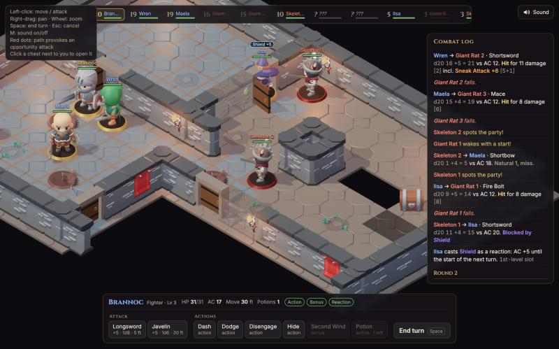
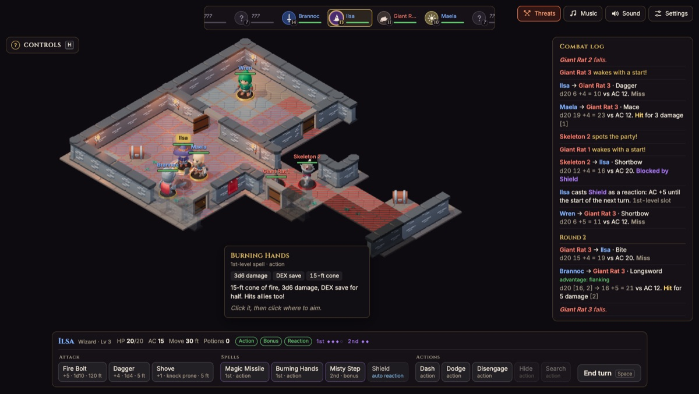
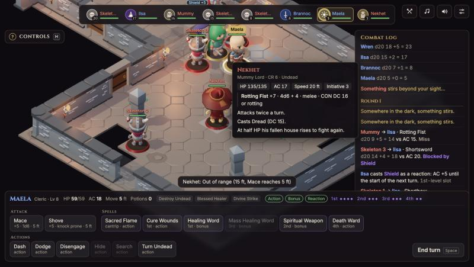

# Crypt Skirmish

Turn-based, isometric dungeon tactics in the browser, built with three.js and SRD 5e-style rules.

**Play it: https://fatihsenel.github.io/crypt-skirmish/**



| | |
| --- | --- |
|  |  |
|  |  |
|  |  |
|  |  |
|  |  |

A party of four fights its way down a crypt on a 5-ft grid, room by room, across four acts.
It runs on desktop and on phones.

**Contents:** [The party](#the-party) · [Rules](#rules) · [Monsters](#monsters) ·
[The dungeon](#the-dungeon) · [The campaign](#the-campaign) · [Modes and extras](#modes-and-extras) ·
[Interface](#interface) · [Sound](#sound) · [Controls](#controls) · [House rules](#house-rules) ·
[For developers](#for-developers) ·
[Credits](#credits)

## The party

| Hero | Class | Highlights |
| --- | --- | --- |
| Brannoc | Fighter | Second Wind, Extra Attack at level 5 |
| | *or* Paladin | Divine Smite, Lay on Hands, Shield of Faith, Aura of Protection |
| Ilsa | Wizard | Magic Missile, Burning Hands, Misty Step, Shield, then Fireball and Lightning Bolt |
| | *or* Warlock | Eldritch Blast, Hex, Scorching Ray, Hellish Rebuke, temp HP on kills |
| Wren | Rogue | Sneak Attack, Cunning Action, hides as a bonus action, spots traps |
| | *or* Ranger | Longbow with Archery, Hunter's Mark, Colossus Slayer |
| Maela | Cleric | Healing, Sacred Flame, Turn Undead, Spiritual Weapon |

- Pick Paladin, Warlock or Ranger and rename the heroes under New campaign on the title screen.
- The party starts at level 3 and reaches level 8. Each level brings new spells, more attacks
  or more spell slots, up to 4th-level spells like Ice Storm and Death Ward.
- Ice Storm leaves its area icy: difficult terrain (each tile costs 10 ft of movement) until
  the end of the caster's next turn. Specters, wraiths and Ysolde fly over it.
- The Ranger is weaker than the SRD version so it doesn't outclass the Rogue.
- The Warlock has two pact slots that come back after every room.

## Rules

- **The basics:** initiative, d20 attacks against AC, critical hits, 30 ft of movement, and
  one action, one bonus action and one reaction a round.
- **Advantage and disadvantage:** flanking, attacking from hiding or against an unaware foe
  gives advantage. Shooting with an enemy next to you, or at someone Dodging, gives
  disadvantage.
- **Opportunity attacks** when you leave an enemy's reach. Disengage avoids them.
- **Actions:** Dash, Dodge, Disengage, Hide, Search, Shove and drinking a potion.
- **Conditions:** prone, poisoned, frightened, restrained and rotting (a mummy's fist: no
  healing takes for two turns), each shown as a tag on the figure.
- **Cover:** barrels and crates give +2 AC against attacks that pass over them.
- **Stealth:** a hidden hero is only found by a monster whose Perception beats their roll.
  Attacking gives you away.
- **Undo:** a move can be taken back until the hero does something else, as long as it rolled
  no dice and showed nothing new (no door, trap, monster or unexplored tile).

## Monsters

- Goblins, skeletons, an orc, giant rats, ghouls, a ghast, a mimic, giant spiders and
  specters.
- Act four: mummies, wraiths and fallen knights.
- Bosses: **Grukk** the goblin chief, **Morvath** the necromancer (raises the dead),
  **Varek** the wight, **Ysolde** the banshee and **Nekhet** the mummy lord (at half HP his
  dead rise again and his glare frightens heroes near him).
- Monsters start unaware. They notice heroes they can see, hear fighting nearby and shout to
  wake their allies. Some sleep, and some patrol.
- Goblins hide after shooting. Monsters that lose sight of a hidden hero go to where they last
  saw them and search.

## The dungeon

- Doors that block sight, hidden spike traps, chests with potions and magic items, and stairs
  down.
- **Fog of war:** you only see what your heroes see. Monsters out of sight are hidden.
- Walls in front of a figure turn see-through.

## The campaign

- **Four acts**, each a map with forks: choose which room to clear next, and whether to rest
  or push on for more XP and loot.
- Between rooms the party takes a short rest, shares XP and hands out magic items at camp.
- **Magic items:** Runed Weapons +1 and +2, Rings and Cloaks of Protection, Bracers of Defense
  (only for a hero in no armor), Gauntlets of Ogre Power, an Amulet of Health and a Periapt of
  Proof against Poison. Each hero's button in the pack shows what the item would change for
  them, such as "AC 15 → 17" or "Max HP 35 → 53".
- A lost fight can be retried or skipped by taking another route. The Defeat screen tells how
  each hero fell, which foe hit hardest and who was still standing, with a tip for next time
  (unused potions, archers, a foe to focus). A won room says who led the way, the closest
  call, who fell and how many potions were drunk.
- **Watch replay:** after any fight you played yourself, the end screen can play it again from
  the start, move by move with the same dice. Pause, step to the next turn, speed it up to 4×,
  or exit back to the end screen (keys: Space, →, + and −, Esc). Copy replay link puts the
  whole fight in a link (on a phone, the share sheet): whoever opens it watches the same fight,
  with nothing sent to a server. A link from before a rules change says it can't be shown.
- **Play it yourself:** a replay opened from a link has a Play it yourself button. You get the
  same room, party, difficulty and starting dice, and the end screen compares your rounds with
  the link's. Try again starts from the same dice; Copy replay link sends your fight back.
  Nothing is saved and no achievements are unlocked.
- **Challenge links:** Copy challenge link on the end screen makes a link that opens straight
  into the same fight, without showing yours first. The end screen then compares the rounds,
  and Watch yours and Watch theirs play both fights.
- **Difficulty:** Story, Normal or Hard. It changes the monsters only; Hard also leaves one
  ghoul out of the Barrow.
- **Saving:** the run saves after every room and in the middle of a fight. Continue picks up
  on the same turn.
- Beating Nekhet shows a tally of the run and each hero's stats. Save image downloads it as a
  picture with the party's gear and the way down (on a phone, the share sheet). A run that ended at Ysolde
  before act four existed carries on into it.
- **New Game+:** after beating Nekhet, go back down with the same heroes from the first room.
  Each one keeps a magic item of your choice from the run. Every win adds a tier (Hard NG+1,
  NG+2, …): monsters get 10% more hit points per tier, and +1 to hit and damage. The title
  screen offers it too, until you start a new campaign. Each hero may also keep nothing.
- **Elites:** from NG+2, the strongest monster in each room is an elite, with a gold band on
  its base, a gold edge on its portrait and one trait: Regenerating, Relentless, Frenzied, Swift,
  Warded or Barbed. The trait depends on the room and the tier: the camp map marks each room ahead
  with a gold pip, and picking it names the trait. When you first see the elite, a horn
  sounds, its band flares, a toast and the log name the trait, and on a phone the camera brings
  it into view. Aiming at a Barbed elite, the hint says what its barbs would cut you for, in
  red when that would drop you. Once you have won a campaign, the bestiary lists what each does and how many
  you've slain. The run summary, its image and Past runs count the elites slain.

## Modes and extras

- **Daily crypt:** one room a day, the same for everyone. Your best result and win streak
  are kept. From 20 November 2026 it can also be the Throne, the Halls or the Armory.
  Win it and Copy result puts a short summary on the clipboard (on a phone, the share sheet).
  A won campaign has the same button. Watch your best replays the day's fastest win from
  the title, and its Copy link and Copy challenge link share it.
- **Weekly elite crypt:** one room a week at New Game+ 3, the same for everyone, with that
  week's elite trait. It's a way to meet elites without a won campaign. Like the daily it
  keeps your best result and a streak of weeks won, and has a Copy result and Watch your best.
  If an update moves the week to another room, its best starts again there.
- **Achievements:** 32 goals that carry across runs. Open them from the title screen.
- **The title's skull** gapes, chatters and twitches on its own, and the embers in its eyes
  follow the pointer and flare at the title's buttons. Click or tap it (or press K) to play its
  moves in turn, each with its own sound: gape, chatter, cocked head, laugh, lunge and the
  torch guttering. A faint glow behind it pulses until the first click. It laughs on the won-campaign screen and chatters at you
  after a defeat, and a still of it shows while the game loads and on the saved run card. With
  Data Saver on or on a 2G connection the title keeps the flat emblem.
- **Bestiary:** every monster you've met, with its character card, a line of lore and how
  many you've slain. A note and a soft chime say when a new one joins, and a gold dot on its button waits
  until you look. Open it from the title screen or camp. It also keeps how much damage each
  kind has dealt your heroes and how many it dropped, with the three deadliest at the top.
- **Past runs:** your last 20 runs, from the title screen. Each keeps its last fight to watch
  again or copy as a link. Your deepest win (such as Hard NG+2) is kept and shown above them.
- **Tips for new players:** short hints the first time something matters. They can be turned
  off.

## Interface

- **Dice on the board:** on your heroes' turns you throw the d20 yourself by clicking,
  tapping or pressing Space. Monsters' rolls and saving throws show too.
- **Enemy reach** (T): marks the tiles monsters could reach and hit next turn. A red
  crosshatch means melee and amber dots mean ranged. Settings can switch them to purple and
  yellow for colour-blind players.
- **Tooltips:** hover or long-press any attack, spell or tag to see what it does.
- **Turn order:** portraits along the top, each with its initiative number. Long names
  shrink to fit, like "G. Spider 2" or "R. Mummy".
- **Character cards:** hover a figure or a portrait (on a phone, tap a portrait or hold a figure) for its HP, AC,
  speed, attacks with to-hit and damage, conditions and traits.
- **Settings:** volume for music, effects and voices, monster turn speed, the dice options,
  motion (System, Reduced or Full) and colour-blind friendly enemy reach.

## Sound

Everything is generated in the browser, with no recordings:

- Music that grows from a quiet drone while exploring to drums and strings in a fight, with
  darker layers in boss rooms.
- Sound effects and dungeon ambience.
- Voices: every character shouts, chants and grunts in a made-up language.
- With reduced motion (the Motion setting, or the system's when it's on System), the screen
  doesn't shake, the camera jumps instead of panning, floating numbers fade in place and the
  dice don't wobble, and the title's skull holds still.
- Screen readers hear the combat log as it happens (even with the log panel closed), whose
  turn it is, and what the keyboard cursor rests on with what Enter would do there. R reads
  out the board around the hero, and the number keys say what they picked. At camp they hear
  how the last room went, which room is next, each room on the map, and items handed out.
- The title, camp and New Game+ work from the keyboard alone: Tab to a room on the map, Enter
  to choose it, and focus stays where it was when the camp redraws.

## Controls

| Mouse and keyboard | Action |
| --- | --- |
| Click a tile | Move (blue = reachable, red dots = provokes an opportunity attack); a party member standing in front of a reachable tile doesn't block the click |
| Click an enemy | Attack with the best weapon in range |
| Attack / spell / action buttons | Pick a specific attack, spell or action |
| Click a chest | Open it when standing next to it |
| Right-drag / wheel | Pan / zoom |
| Arrow keys | Move a cursor over the board, starting at your hero |
| Enter on the cursor | Pick the tile (the hint shows what happens), Enter again to do it |
| 1–9, 0 | Pick the action bar's first ten buttons in order (attacks, spells, actions); the number shows on each |
| R | Read out the hero, enemies in sight (distance, HP, in range) and who's down |
| Space or Enter | End turn (or throw the die when it's waiting) |
| Esc | Un-pick the tile, cancel the selected attack or spell, then put the cursor away |
| Z | Undo the last move |
| T | Show or hide enemy reach |
| M / N | Sound / music on or off |
| H or ? | Show or hide the controls panel |
| L | Open or close the combat log |
| K | On the title, or a defeat or the won campaign: the skull plays its next move |
| Tab / Esc in a panel | Tab stays inside the panel; Esc closes it |

| Touch | Action |
| --- | --- |
| Tap a tile, enemy or chest | Preview what would happen |
| Tap the same spot again | Do it |
| Drag / pinch | Pan / zoom |
| Undo button | Take back the last move |
| Hold a button, or tap a tag | Show its tooltip |
| Tap a portrait or hold a figure | Show the character card |
| Log button (top right) | Open the combat log |

## House rules

A few things differ from the SRD to keep the game simple:

- Goblin arrows and rat bites poison (DC 10 CON). Ghoul claws poison instead of paralysing.
- The mimic knocks you prone instead of grappling.
- Only Grukk's second attack has disadvantage.
- Sculpt Spells and Sneak Attack 4d6 arrive at level 6. Sculpt spares every ally.
- The ghast's stench only lasts until the end of the victim's turn.
- A giant spider's bite poisons instead of dealing poison damage, and its web wears off on
  its own.
- A specter's Life Drain frightens instead of lowering maximum HP. The banshee has no Wail.
- Mummy rot is a short curse instead of a lasting one: on a failed CON save (DC 12, Nekhet's
  DC 16) the target can't regain HP for two of its turns. The wraith's Life Drain doesn't lower maximum HP and
  it raises no specters. Nekhet has no legendary actions or cleric spells. Instead, once a fight at half HP, two
  skeletons rise for him and heroes within 10 ft make a WIS save or are frightened.
- The Fighter's Improved Critical comes at level 7. A hero can use one runed weapon at a time.
- Gauntlets of Ogre Power also add +1 damage with Strength weapons, so they still help a
  hero whose Strength is already 19 or more.
- Hex has no ability-check part and lasts the whole fight, with no concentration.
- Every Scorching Ray aims at one foe. Rays left when it falls go to the nearest other foe.
- Hellish Rebuke is armed ahead of time and only answers attacks.
- New Game+ is not from the SRD: each tier adds 10% to monster hit points (on top of the
  difficulty's), and from the first tier their weapon attack and damage rolls get +1.
- Elites (NG+2 and deeper) are not from the SRD: the room's monster worth the most XP gets a
  trait (regains 5 HP a turn; stays on 1 HP once; one more attack; +10 ft speed; +2 AC and
  no frightened, prone or poisoned; or 3 piercing damage, no roll, to a foe that hits it with
  a melee weapon).

## For developers

### Run

```bash
npm install
npm run dev      # http://localhost:5173
npm test         # rules unit tests (Vitest)
npm run lint     # ESLint: undefined names and unused code
npm run sim      # balance check: plays whole campaigns headlessly
npm run touch-check  # headless Chrome taps on a phone: first tap previews, second acts
npm run stills   # re-renders the icons, link preview, boot still and README shots of the 3D emblem
npm run build    # production bundle in dist/
npm run preview  # http://localhost:4173/crypt-skirmish/
```

Every push to `main` runs lint and the tests, builds, runs the touch check on three fixed fights against the
build (and once with each finger lifted late, as a busy phone sees it) and deploys to GitHub Pages (`.github/workflows/pages.yml`).

**Jump into a room:** `http://localhost:5173/?level=4` (1 Crypt, 2 Warren, 3 Ossuary,
4 Sanctum, 5 Catacombs, 6 Vault, 7 Barrow, 8 Larder, 9 Nest, 10 Gallery, 11 Throne,
12 Halls, 13 Armory, 14 Tomb). Add `&difficulty=hard` or `story`, `&party=5` for another level (3 to 8), `&tier=1` for New Game+, `&paladin`, `&ranger` or `&warlock`, `&seed=7` for the same dice every time.
This doesn't touch the save.

**See the ending:** `http://localhost:5173/?victory` shows the won-campaign screen for a made-up run,
to try Copy result and Save image (on a phone, the share sheet). Add `&tier=2` for a New Game+
run with elites slain. Nothing is saved.

**Console:** `__debug.autoplay()` lets the AI play the heroes too. `__debug.win()` and
`__debug.lose()` end the fight.

### Balance

`scripts/sim.js` plays the campaign without graphics and prints win rates.

- `npm run sim -- 300` plays 300 campaigns down each route.
- `npm run sim -- 300 act2`, `act3` or `act4` plays just that act, starting from real parties
  that finished the act before.
- `npm run sim -- 300 full` plays whole runs, first room to the Tomb, and says where they end.
- Runs are split over one worker thread per core; `JOBS=1` plays them on one thread (the same
  numbers as before threads, for a given `SEED`).
- `SEED=n`, `DIFFICULTY=story|hard`, `TIER=n` (New Game+), `PALADIN=1`, `RANGER=1` and `WARLOCK=1` change the run.

Each act's boss is won almost every time by a rested party and noticeably less often by a
party that skipped the rest. On Normal the Throne is won about 98% of the time after a rest
and about 80% without one. The Tomb is the same: about 95% after the Hearth and 75% after the
Armory. On Hard the Throne drops to about 95% and 60%, and the Tomb to about 80% and 35%.
A whole run (1,500 simulated) wins about 97% of the time on Story, 72% on Normal and 32% on
Hard (monsters get +20% HP and +1 to hit and damage). On both the Tomb ends the most runs. Samples of 300 runs swing by about 5 points either way.

### Layout

```
src/
  game/              pure rules, no three.js (unit-testable)
    dice.js          dice rolling and ability modifiers
    grid.js          map grid, movement, line of sight, fog of war
    units.js         stat blocks, XP values and level-ups
    items.js         magic items
    abilities.js     actions and spells
    campaign.js      the dungeon map, XP, the pack, rests, New Game+, save data
    maps.js          the rooms as ASCII maps
    combat.js        Game: turns, movement, attacks, events
    spells.js        spell slots, targeting, saves and casting (Game builds on it)
    ai.js            monster brains
    replay.js        fight saves: commands replayed from a seed
    recap.js         a fight told back: who fell to what and a tip, or who led a win
    history.js       past runs and the last fight of each
    fightLink.js     a fight as a #watch= link, checked by replaying it; #play= challenges and their end text
    achievements.js  achievements and their checks
    bestiary.js      which monsters you've met and slain, and what they did to you
    daily.js         the daily crypt
    weekly.js        the weekly elite crypt
    settings.js      settings kept in the browser
  render/            three.js only
    stage.js         renderer, camera, lights, screen shake, labels kept apart
    board.js         dungeon meshes, highlights, fog of war, wall fading
    dungeonKit.js    loads the dungeon tiles
    gltfModels.js    loads the character models and plays their animations
    modelSpecs.js    which model and clips each unit uses
    models.js        procedural figures (the mimic and fallbacks)
    unitView.js      a unit's base, label and animations
    effects.js       spell effects, hit particles
    rollBadge.js     the d20 badge over attacks and saves
    tween.js         promise-based tweening and playback speed
    titleLogo.js     the 3D emblem (title and won campaign): the skull, its jaw, the mist and wisps
  audio/             sfx.js, music.js, voices.js (all procedural)
  ui/
    hud.js           initiative, action bar, combat log
    announce.js      what a screen reader hears: log lines, turns, the keyboard cursor, camp news
    replayBar.js     the replay bar: pause, next turn, speed and their keys
    runCard.js       the won campaign drawn as a picture to save
    camp.js          title screen and camp
    heirlooms.js     New Game+: the item each hero keeps
    settings.js      the settings panel
    abilityTip.js    tooltip cards for attacks, spells and actions
    unitTip.js       the character card over figures and portraits
    unitCard.js      the character card's text
    bestiary.js      the bestiary screen and its lore
    banner.js        the end-of-fight banner: result, recap, run summary, Copy result, Save image
    overlay.js       panels over the screen (bestiary, past runs, achievements, New Game+)
    icons.js         portrait icons for the turn order
    tips.js          tips for new players
  main.js            controller: game → animations → HUD
  controls.js        mouse, touch and keyboard: the arrow-key cursor and the shortcut keys
  preview.js         what a click on the hovered tile would do: the path, the odds, a spell's blast
  fightEnd.js        a finished fight's records: runs, achievements, dailies, the end banner's facts
  animate.js         plays back resolved attacks, moves, chests, actions and spells
  links.js           copying and opening #watch= and #play= links
  threats.js         threat zones: the T toggle and a monster's reach from its portrait
  input.js           picking a tile, the long press, what a click does, the cursor's step and words
  debug.js           window.__debug and the ?victory sample run
tests/               Vitest rules, replay and input tests, and a check that every spell animates
scripts/
  sim.js             headless balance simulator
  touch-check.mjs    real touch taps in headless Chrome against the dev server (URL= for another)
  stills.mjs         stills of the 3D emblem and the README shots that show it (npm run stills)
  trim-models.js     strips unused animation clips from the models
  compress-models.js meshopt-compresses every .glb (npm run models)
```

The rules engine resolves everything instantly and emits events (`attack`, `move`, `spell`,
`death`, …). The controller plays them back as animations, so the visuals can change without
touching the rules.

Models load room by room, so a fight only waits for its own figures. They are trimmed to the
clips the game uses and meshopt-compressed (about 1.1 MB of characters). To add a clip, bring
back the original file from git history, then trim and compress again.

## Credits

- **Characters:** KayKit Adventurers and KayKit Skeletons by Kay Lousberg
  (www.kaylousberg.com), CC0.
- **Monsters:** the orc, specters, giant rats and spiders by Quaternius (quaternius.com), CC0,
  via Poly Pizza.
- **Dungeon tiles and props:** KayKit Dungeon Remastered by Kay Lousberg, CC0.
- **Logo and icons:** the flat emblem and the favicon are drawn for the game as SVG. The
  lettering uses Cinzel from Google Fonts. The title's 3D skull is "Human Skull" by CDmir on OpenGameArt, CC0; the doorway, sword and
  staff around it are built in code. The app icons, the link preview and the loading screen's
  emblem are stills of it.
- License files are in `public/models`. If a model fails to load, the game falls back to a
  simple procedural figure.

Rules content follows the SRD 5.1 (CC-BY-4.0). Credit it if you publish, and avoid non-SRD
names and Wizards of the Coast trademarks.
